<p align="center">
  <a href="https://github.com/OuincheWinch/DiffusionBear/releases/tag/v0.4.1">
    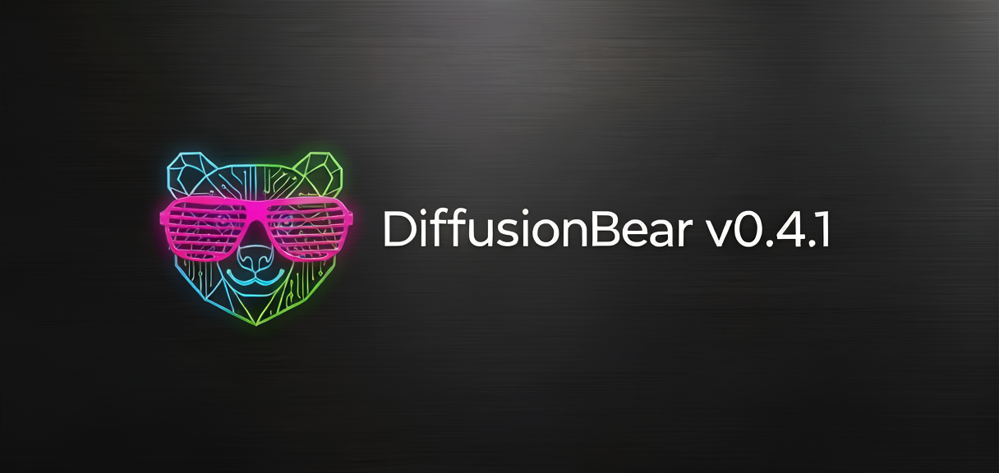
  </a>
</p>

<h1 align="center">DiffusionBear</h1>

<p align="center"><strong>v0.4.1</strong> &nbsp;·&nbsp; a local-first image generation studio for Apple Silicon</p>

<p align="center">
  <a href="https://www.diffusionbear.com"><strong>Website</strong></a> &nbsp;·&nbsp;
  <a href="https://x.com/DiffusionBear"><strong>x.com/DiffusionBear</strong></a> &nbsp;·&nbsp;
  <a href="https://diffusionbear.com/discord"><strong>Discord</strong></a>
</p>

---

**DiffusionBear** A free macOS studio that runs SDXL (and its derivatives), FLUX.1, FLUX.2 Klein 4B/9B, FLUX.3 Klein 5.6B, MOSS-Image SFT 5B, Qwen-Image-2.1 & Turbo, Krea 2 Turbo, and Z-Image-Turbo on your Mac's own Metal GPU. No account, no cloud, no per-image
billing.

It is built on Apple's [MLX](https://github.com/ml-explore/mlx) framework, so it is
**Apple Silicon only**. There is no CUDA or CPU path — MLX is macOS/Metal
exclusive.


Made by **[Ouinche](https://www.ouinche.com)** — follow on X:
**[x.com/DiffusionBear](https://x.com/DiffusionBear)** 
— released under the [MIT licence](LICENSE).

---

## What's new in v0.4.1 (beta)

- **SDXL Metal Memory Stabilization:** Systematic Metal buffer clearing and working-set memory management (+51.9% suite-wide speedup, 4.25x faster on Juggernaut XL Lightning down to 9.2s).
- **Generation Pipeline Optimization:** Lossless JIT compilation (`@mx.compile`), sub-second TAESD VAE decoding, and `euler_trailing` timesteps restoring 100% visual parity (&infin; dB PSNR).
- **Interactive 187-Run Benchmark Arena:** Explore all 17 model configurations with our interactive comparison slider at [diffusionbear.com/benchmark.html](https://www.diffusionbear.com/benchmark.html).

## What's new in v0.4.0 (beta)
- **Virtual Boxes on the Studio Canvas:** Draw, resize, and label color-coded spatial bounding boxes right on the canvas for **FLUX.3-klein 5.6B** and **MOSS-Image SFT 5B** to position subjects, characters, and exact poster typography without ControlNet.
- **Smart 16 GB Unified Memory Management:** 
- **Gallery Favorites & Privacy Card Blur:** 
- **Custom Python Samplers:** 
- **DiffusionBee & Draw Things Local Library Import:** if you allow DiffusionBear to read theirs directories
---

## Install the App & First-Launch Gatekeeper Guide

`DiffusionBear.app` is a self-contained macOS application: it bundles the backend, two relocatable Python/MLX runtimes, and the studio interface inside one `.app`. **You do not need to install Python, Node, Xcode, or Homebrew.**

**[⬇ Download DiffusionBear v0.4.1 for macOS (Apple Silicon)](https://github.com/OuincheWinch/DiffusionBear/releases/download/v0.4.1/DiffusionBear-0.4.1-arm64.zip)** &nbsp;·&nbsp; [v0.4.1 Release Notes & Checksums](https://github.com/OuincheWinch/DiffusionBear/releases/tag/v0.4.1)

| | Detail |
|---|---|
| **Requires** | An Apple Silicon Mac (M1 / M2 / M3 / M4 / M5 / M6), **macOS 26.2 or later**, 16 GB unified memory recommended. |
| **Your files** | Settings, gallery, LoRA registry, and model store live in `~/Library/Application Support/DiffusionBear`. To put the store on an external drive, write an absolute path into `~/Library/Application Support/DiffusionBear/store_path`. |
| **Model weights** | Downloaded on first use from Hugging Face or [Civitai](https://civitai.red/?ref_code=88C8VEBA) into your local store. After that, the app works 100% offline. |

### 🍎 How to Open on First Launch (macOS Gatekeeper Bypass)

Because DiffusionBear is a free, open-source project signed ad-hoc (without a paid Apple Developer ID notarization certificate), macOS Gatekeeper pauses the very first double-click of a downloaded copy with this dialog:

<p align="center">
  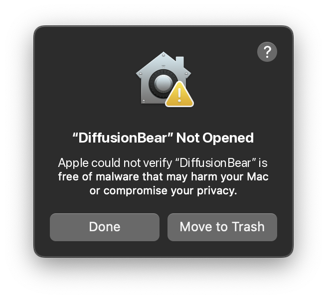
</p>

> **"DiffusionBear" Not Opened** — *Apple could not verify "DiffusionBear" is free of malware that may harm your Mac or compromise your privacy.*

**Follow this one-time 60-second procedure:**

1. **Unzip and move to `/Applications`:** Unzip `DiffusionBear-0.4.1-arm64.zip` and drag **`DiffusionBear.app`** into your **/Applications** folder *(do not launch it from `~/Downloads` or inside the zip)*.
2. **Bypass Gatekeeper (choose Option A or Option B):**
   * **Option A — Fastest (Terminal 1-Liner):** Open **Terminal.app**, paste this command, and press Return:
     ```bash
     xattr -cr /Applications/DiffusionBear.app
     ```
     Then double-click **`DiffusionBear.app`** in `/Applications` — it opens right away!
   * **Option B — No Terminal (System Settings GUI):**
     1. Click **Done** on the Gatekeeper dialog.
     2. Open **System Settings → Privacy & Security**.
     3. Scroll down to the **Security** section (*"DiffusionBear was blocked to protect your Mac"*).
     4. Click **Open Anyway**, authenticate with Touch ID or your password, and click **Open**.

Once authorized, macOS remembers your choice and **never shows the alert again**.

---

## Supported models

**Twelve+ checkpoints across eight families**, 4-bit quantised and memory-tuned for 16 GB of unified memory. Switching engines swaps weights on demand rather than keeping everything resident.

| Model | Family | Default steps | What it supports |
|---|---|---|---|
| **SDXL & Derivatives** *(Juggernaut XL Lightning, RealVisXL V5.0 Lightning / Hyper-SD, Juggernaut XI v11, Custom SDXL / Pony / Illustrious)* | SDXL | 4–50 | Ultra-fast 4-step Lightning (~9s) or full 20–50 step custom `.safetensors` checkpoints (auto-converted), negative prompts, sampler picker, CLIP Skip, DeepCache, and TAESD fast decode. |
| **FLUX.1-schnell** | FLUX.1 | 4 | Classic 4-step rectified flow, 1 reference image, FLUX.1 LoRAs, and fast-VAE decode. |
| **FLUX.2-klein 4B** | FLUX.2 | 4 | Up to 10 reference images, FLUX.2 LoRAs, and generative fill. Guidance-distilled (no negative prompt). |
| **FLUX.2-klein 9B** | FLUX.2 | 4 | 9-billion-parameter flagship DiT with up to 10 reference images, LoRAs, and superior detail. |
| **FLUX.3-klein 5.6B** | FLUX.3 | 16 | 16-step flow-matching distilled, up to 10 reference images, and interactive **Virtual Boxes** on the Studio Canvas. |
| **MOSS-Image SFT 5B** *(+ Base 5B)* | MOSS | 4–8 (DMD) / 25 | Interactive **Virtual Boxes**, reference image, LoRAs, MLX q8-g64 text encoder, and automatic **4-step (`⚡ DMD 4`) / 8-step (`⚡ DMD 8`)** distillation adapters. |
| **Qwen-Image-2.1** | Qwen-Image | 25 | 7B single-stream DiT with Qwen3-VL text encoder, 1 reference image, and negative prompts. |
| **Qwen-Image-Turbo-2.1** | Qwen-Image | 8 | 8-step distilled Qwen-Image 2.1 variant for fast generation on 16 GB Macs. |
| **Krea 2 Turbo 13B** | Krea 2 | 4–8 | 13B photorealistic engine with 1 reference image, LoRAs, persistent Q4 text-encoder cache, and auto-applied 4-step distilled LoRA. |
| **Z-Image-Turbo 6B** | Z-Image | 6–8 | Compact 6B engine with 1 reference image, LoRAs, fast VAE, and crisp architectural geometry. |

**Bring any SDXL, Pony, or Illustrious checkpoint you own:** single-file Civitai `.safetensors` checkpoints are converted in place, unlisted models can be onboarded from a local folder or your Hugging Face cache, and the app also browses models and LoRAs already downloaded by **Draw Things** and **DiffusionBee** (strictly read-only).

---

## Screenshots & MOSS-Image Showcase Gallery (v0.4.1)

All images below were generated locally in DiffusionBear on an **Apple MacBook Pro M1 with 16 GB of RAM**.

### 🏆 Featured MOSS-Image SFT 5B Generation (Apple Silicon Native)

<p align="center">
  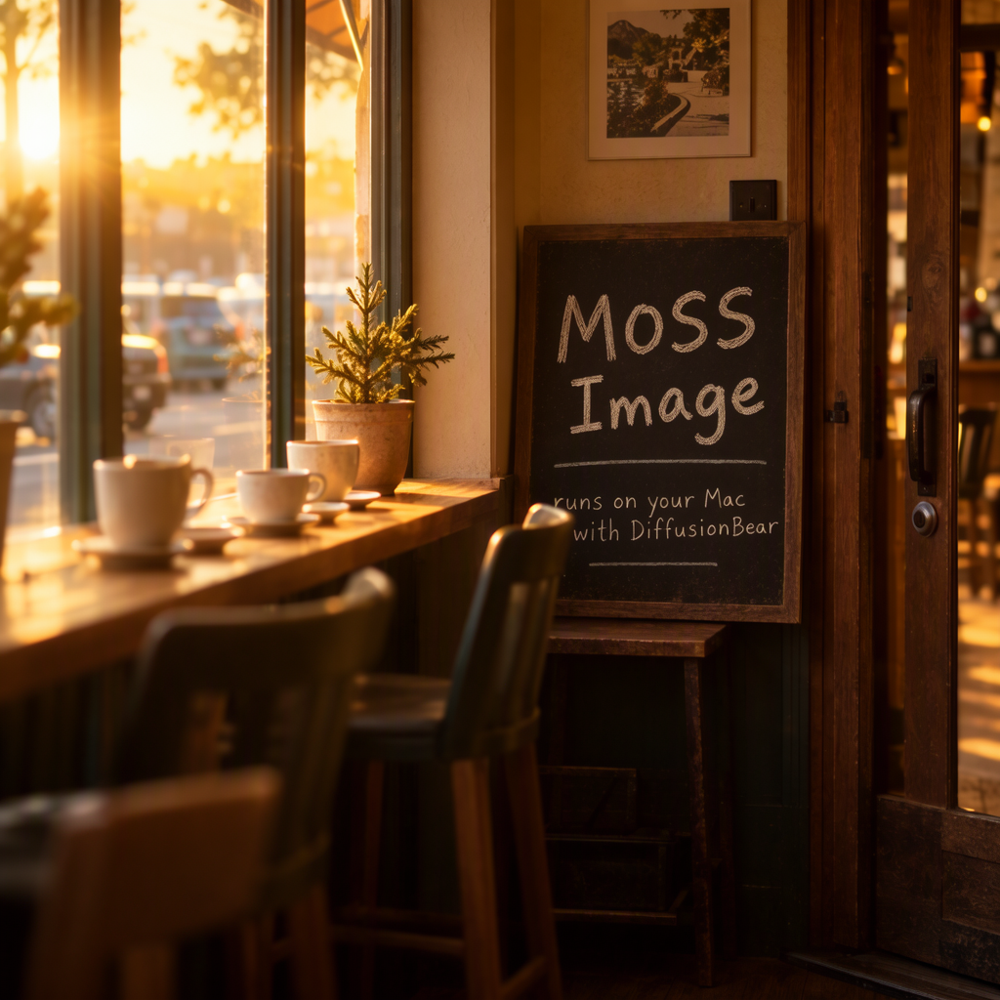
</p>

> ☕ **Prompt:** *"A cozy corner café at golden hour. A chalkboard sign by the door reads "MOSS Image" in hand-drawn lettering, with “runs on your Mac with DiffusionBear" written smaller underneath. Warm light pours through the window onto a wooden counter with ceramic cups. Shallow depth of field, 35mm photograph, natural colors."*
>
> **Generation Metadata (Generated Locally in DiffusionBear):**  
> • **Hardware:** Apple MacBook Pro M1 (16 GB Unified Memory / RAM)  
> • **Generation Time:** `7,525.2 s` (~2 h 05 min — full stock 50-step CFG trajectory)  
> • **Active LoRAs:** None (Base MOSS-Image pipeline)  
> • **Model:** `OpenMOSS-Team/MOSS-Image-SFT` (5B Parameters, Native MLX Text Encoder)  
> • **Resolution:** `1024 × 1024` &nbsp;·&nbsp; **Steps:** `50` (Stock CFG Flow-Matching Euler Trajectory)  
> • **Guidance (CFG):** `3.0` &nbsp;·&nbsp; **Sampler:** `flow_match_euler_discrete` &nbsp;·&nbsp; **Seed:** `1000`  
> • **Text Encoder:** Custom 8-bit MLX Quantized Qwen3.5 TE ([`Ouinche/moss-image-qwen3.5-te-mlx-q8g64`](https://huggingface.co/Ouinche/moss-image-qwen3.5-te-mlx-q8g64))

---

### 🎨 MOSS-Image Studio Gallery (⚡ DMD 4-Step, ⚡ DMD 8-Step & Virtual Boxes)

The following original images demonstrate the versatility of **MOSS-Image SFT 5B** inside DiffusionBear on a **MacBook Pro M1 (16 GB RAM)**, using both built-in **DMD step-distillation adapters** (generating in 7–13 minutes instead of 2 hours) and interactive **Virtual Boxes** spatial layout:

| Studio Product — Matte Sneaker (⚡ DMD 8-Step) | Alpine Lakes Minimalist Poster (⚡ DMD 4-Step) |
| :---: | :---: |
| 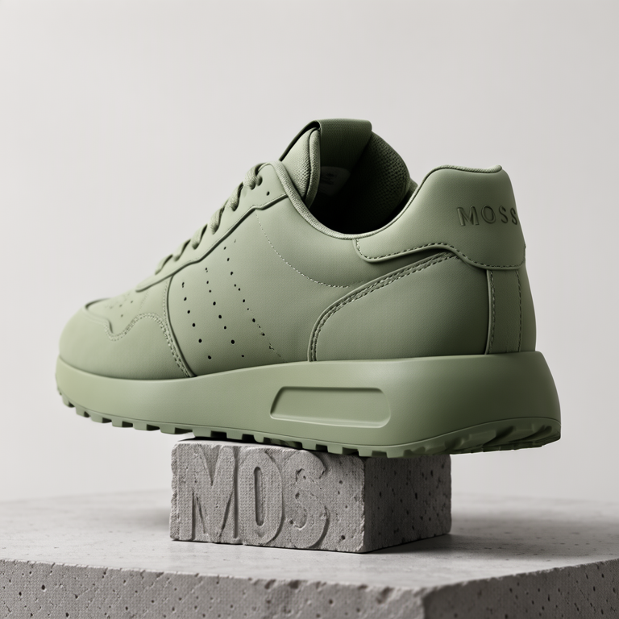 | 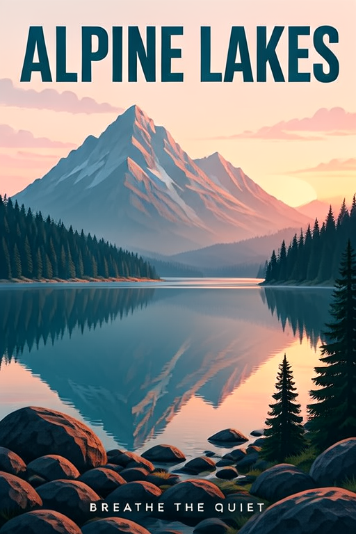 |
| **Prompt:** *"Studio product photograph of a matte moss-green sneaker resting on a rough grey stone pedestal. Soft diffused lighting, seamless off-white backdrop, the word 'MOSS' embossed on the heel tab. Crisp fabric texture, subtle shadow, high detail."*<br>• **Hardware:** MacBook Pro M1 (16 GB RAM)<br>• **Generation time:** 825.1 s (~13 min 45 s)<br>• **Active LoRA:** `lodestones-8step` (scale 1.0, ⚡ DMD 8-step kit)<br>• **Model:** MOSS-Image SFT 5B + ⚡ DMD 8<br>• **Size:** 768×768 · **Steps:** 8 (CFG 1.0)<br>• **Sampler:** `moss_dataspace_dmd` · **Seed:** 1003 | **Prompt:** *"A minimalist travel poster of a still mountain lake at dawn, flat vector style with soft gradients. A bold title 'ALPINE LAKES' across the top and the tagline 'breathe the quiet' in small capitals along the bottom. Teal, cream and dusty pink palette, clean typography, centered composition."*<br>• **Hardware:** MacBook Pro M1 (16 GB RAM)<br>• **Generation time:** 464.1 s (~7 min 44 s)<br>• **Active LoRA:** `darask0-4step` (scale 1.0, ⚡ DMD 4-step kit)<br>• **Model:** MOSS-Image SFT 5B + ⚡ DMD 4<br>• **Size:** 512×768 · **Steps:** 4 (CFG 1.0)<br>• **Sampler:** `moss_dataspace_dmd` · **Seed:** 1002 |

| Vintage Botanical Plate — Bryophyta (⚡ DMD 4-Step) | Vintage Pink Shutter Shades (⚡ DMD 4-Step) |
| :---: | :---: |
|  | 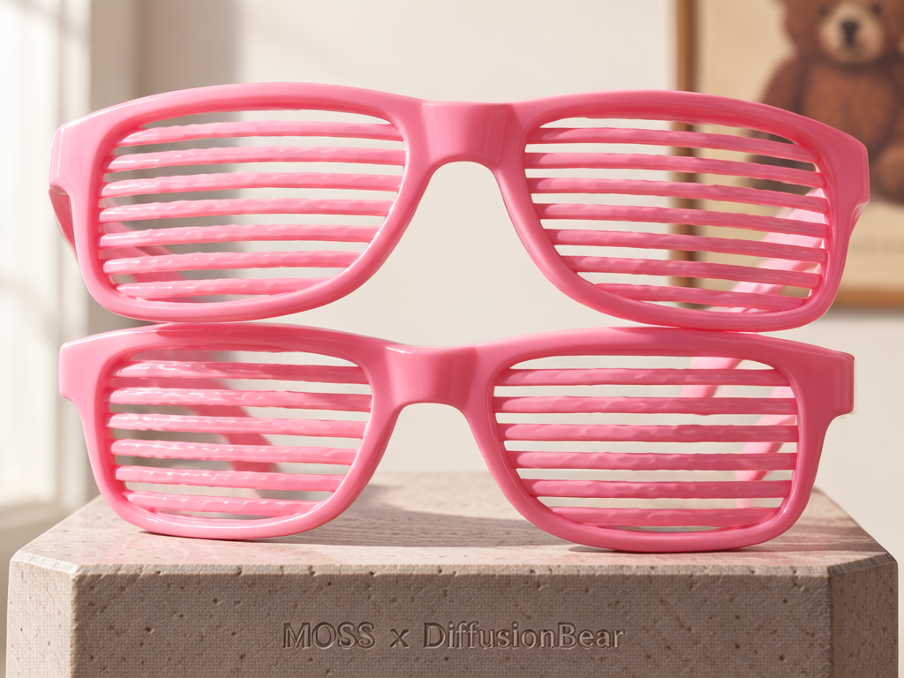 |
| **Prompt:** *"A vintage botanical illustration plate of forest moss and ferns on aged cream paper, fine ink linework with watercolor washes. A caption at the bottom in serif type reads 'Bryophyta' and below it, smaller, 'plate XII'. Scientific illustration style, balanced layout."*<br>• **Hardware:** MacBook Pro M1 (16 GB RAM)<br>• **Generation time:** 497.9 s (~8 min 18 s)<br>• **Active LoRA:** `darask0-4step` (scale 1.0, ⚡ DMD 4-step kit)<br>• **Model:** MOSS-Image SFT 5B + ⚡ DMD 4<br>• **Size:** 1024×1024 · **Steps:** 4 (CFG 1.0)<br>• **Sampler:** `moss_dataspace_dmd` · **Seed:** 1005 | **Prompt:** *"A studio photograph of a pair of vintage pink plastic shutter shades, resting on a stone pedestal. Facing the viewer. Novelty sunglasses feature a molded pink frame with horizontal slats... backdrop with poster on the wall, the word 'MOSS x DiffusionBear' engraved on the stone base."*<br>• **Hardware:** MacBook Pro M1 (16 GB RAM)<br>• **Generation time:** 795.1 s (~13 min 15 s)<br>• **Active LoRA:** `darask0-4step` (scale 1.0, ⚡ DMD 4-step kit)<br>• **Model:** MOSS-Image SFT 5B + ⚡ DMD 4<br>• **Size:** 1024×768 · **Steps:** 4 (CFG 1.0)<br>• **Sampler:** `moss_dataspace_dmd` · **Seed:** 1003 |

| Interactive Virtual Boxes: Multi-Subject Spatial Layout (⚡ DMD 4-Step) |
| :---: |
| 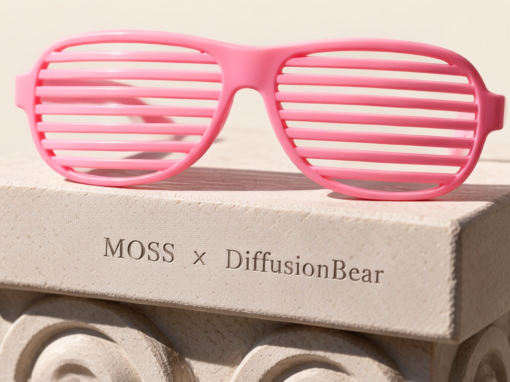 |
| **Virtual Box Spatial Layout:** Studio scene with shutter shades on stone pedestal + interactive bounded box `wall_1` (`[35, 0, 527, 1000]`): *"Logo from Image 1 posterized on the wall"*<br>• **Hardware:** MacBook Pro M1 (16 GB RAM)<br>• **Generation time:** 415.2 s (~6 min 55 s)<br>• **Active LoRA:** `darask0-4step` (scale 1.0, ⚡ DMD 4-step kit)<br>• **Model:** MOSS-Image SFT 5B + ⚡ DMD 4 (`darask0-4step`) with **Studio Virtual Boxes**<br>• **Size:** 1024×768 · **Steps:** 4 (CFG 1.0) · **Sampler:** `moss_dataspace_dmd` · **Seed:** 1003<br>• ⚠️ **Notice Image de référence :** *Une image de référence a été fournie lors de ce test ("Logo from Image 1..."), mais **les images de référence ne fonctionnent pas sur MOSS-Image** (MOSS-Image est un modèle purement text-to-image et layout-to-image ; le conditionnement par image de référence n'est pas supporté par l'architecture du modèle et est ignoré). La disposition spatiale a été pilotée uniquement par la Virtual Box.* |

---

### 🖥️ Studio Interface Screenshots (v0.4.1)

| Studio Generation (Dark Mode) | Studio Generation (Light Mode) |
|---|---|
| 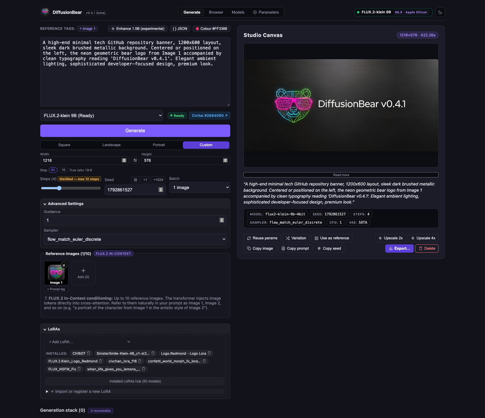 | 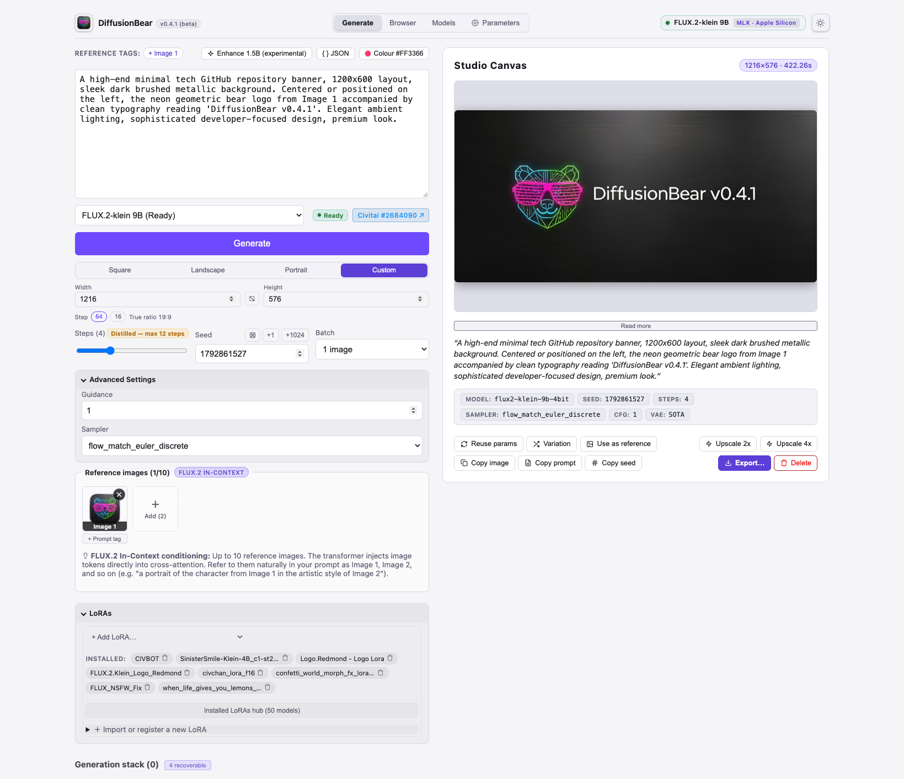 |

| Gallery / Browser (Dark Mode) | Gallery / Browser (Light Mode) |
|---|---|
| 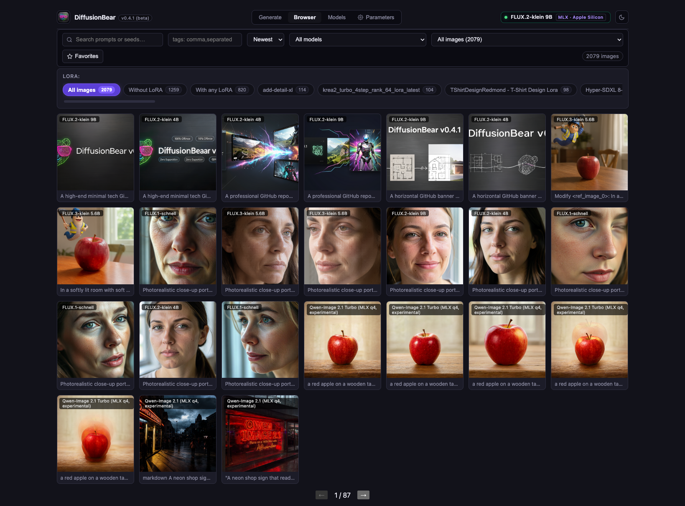 | 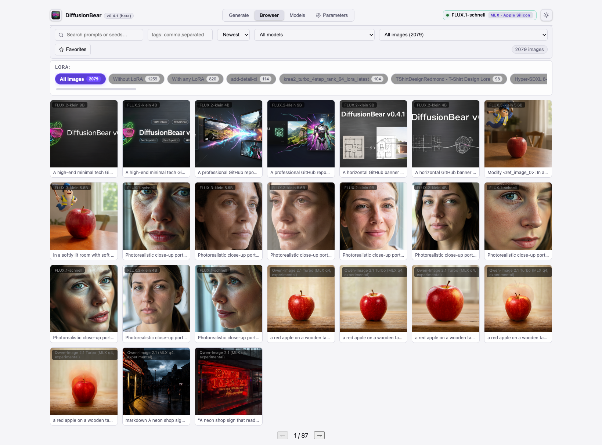 |

| Models: Installed & Manage | Models: External Disk Detection (Draw Things & DiffusionBee) |
|---|---|
| 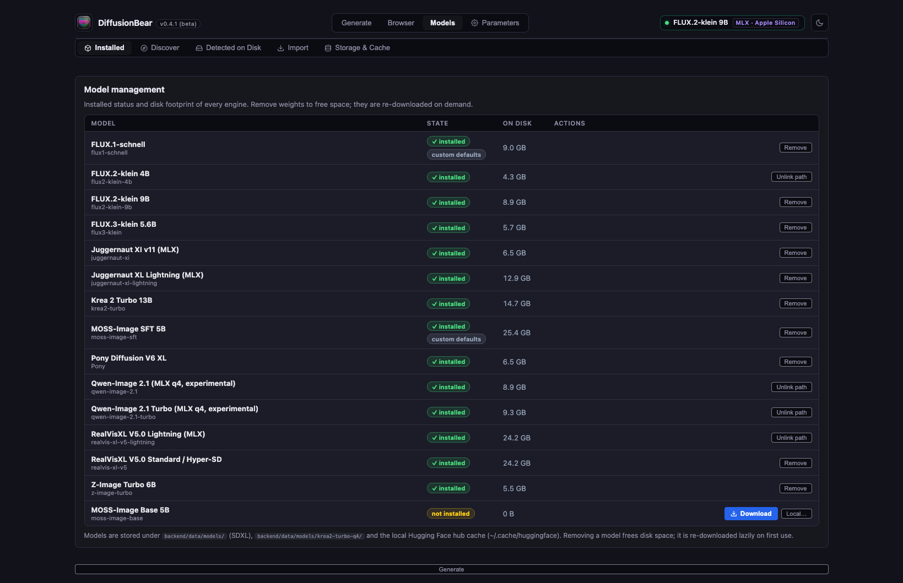 | 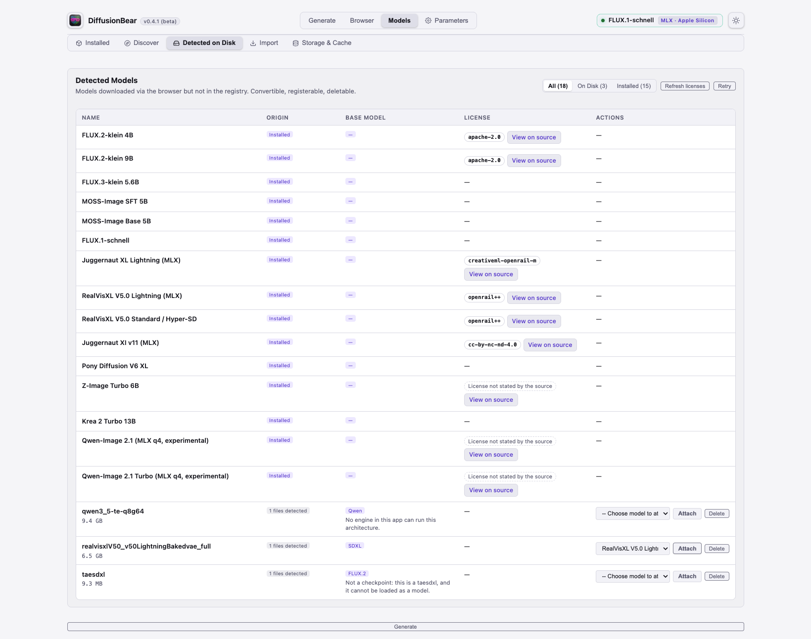 |

| Parameters: Engine, GPU Memory & Model Defaults | Parameters: Language & System Preferences |
|---|---|
| 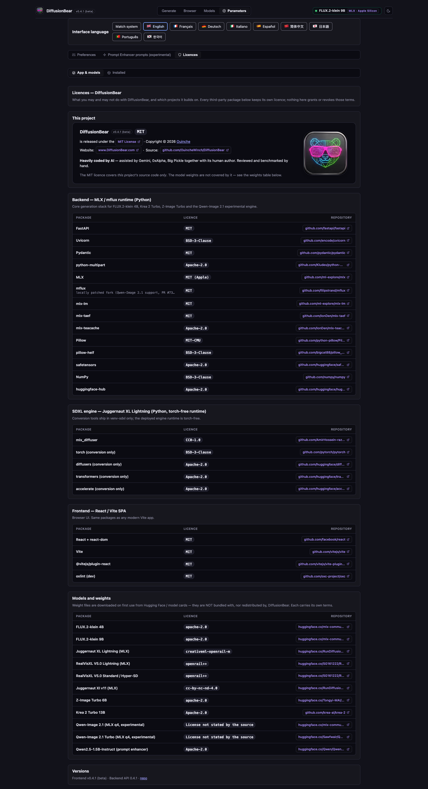 | 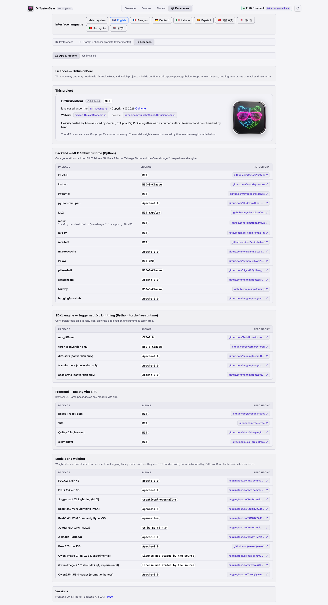 |

---

## Virtual boxes — place things where you want them

Three engines (FLUX.3-klein, MOSS-Image SFT and Base) accept **spatial boxes**:
instead of hoping the model puts the cat in the right corner, you draw a box on
the Studio Canvas and say what belongs inside it. The canvas can show a
reference image as a backdrop, so you compose over the actual picture you want.

- **SPATIAL BOX panel:** presets (Center / Left / Right / Top / Bottom / full
  frame), free boxes you drag on the canvas, and a live count.
- **Compose** turns your caption + boxes into the layout description the engine
  understands; **JSON** shows exactly what will be sent.
- **Reference backdrops:** overlay any gallery image or reference behind the
  boxes, hide it or remove it at will.
- The layout travels with the generation metadata, so reusing parameters
  reproduces the composition.

For FLUX.2-klein, the equivalent is **generative fill**: paint a mask on a
gallery image and regenerate just that region.

---

## Memory management, quietly handled

Running 4–13 B parameter models on a 16 GB Mac is a memory-budget problem. The
app manages it; you watch (Parameters → Engine & GPU) rather than tune:

- **Auto wired-limit.** Each engine's GPU wired budget is derived from your
  machine — `min(68% of unified memory, Apple's recommended working set)`, about
  **10.9 GB on a 16 GB Mac**. An explicit number you set still wins; `0` means
  unbounded.
- **Idle auto-release.** Resident pipelines (a full FLUX/Krea2 pipeline is
  ~10 GB) are released after **5 minutes of inactivity** (300 s default,
  tunable per engine; `0` = never release). Reloading afterwards costs a few
  seconds, not minutes — macOS keeps the weight files in its file cache.
- **Quantised everything.** Weights are 4-bit by default; the MOSS text encoder
  is swapped for the app's own **MLX q8g64 build (~2.2 GB)** and the Krea 2
  encoder is quantised once and persisted, so later sessions skip both the
  7.5 GB bf16 load and the quantisation pass.
- **Live panel.** Metal memory in use, peak, the wired limits, which pipelines
  are resident, and the idle countdowns — all visible, nothing hidden.
- **Storage cleanup.** The Parameters tab reports generated-image size, TAESD
  state and settings, and the Models tab clears per-repo Hugging Face cache
  entries to reclaim disk space.

### MOSS-Image DMD distillation (default behaviour)

Each MOSS DMD kit is three files that only work together: a projection **LoRA**,
a distilled fp32 **time embedding**, and a **dataspace** file holding the
CFG-free step schedule. The **DMD distillation** control has four positions:

| Mode | Adapter used | Schedule |
|---|---|---|
| **Auto** *(default)* | follows the step slider: ≤4 steps → DMD 4, ≤8 → DMD 8, above → stock | stock CFG trajectory above 8 steps |
| **⚡ DMD 4** | darask0's 4-step kit (`moss_distill/darask0-4step`) | CFG-free, engine clamps the run to the 4 codes |
| **⚡ DMD 8** | lodestones' 8-step kit ([`lodestones/MOSS-Image-SFT-8-steps-dmd`](https://huggingface.co/lodestones/MOSS-Image-SFT-8-steps-dmd), Apache-2.0) | CFG-free, engine clamps the run to the 8 codes |
| **Stock** | none | full CFG trajectory at the requested steps (~20–45 min) |

Forcing DMD 4 or DMD 8 at a higher requested step count still runs the 4- or
8-step codes (the engine clamps the loop and drops CFG, which has no effect on
the dataspace schedule). On a 16 GB M1 that is roughly **1 min (4 steps)** /
**3 min (8 steps)** at 768×512, against 20–45 min stock. If a kit is missing
the app **downloads it automatically** when the run needs it (resumable); with
no network it falls back to the stock trajectory rather than failing.

---

## Local by design

- **Generation runs on the Metal GPU** through MLX (`mflux` for the
  flow-matching families, a native MLX daemon for SDXL, dedicated engines for
  MOSS and Qwen). Weights are 4-bit so a 4–13 B model fits a 16 GB machine.
- **The prompt enhancer is a local LLM too** (Qwen2.5 0.5B or 1.5B, MLX) —
  rewriting a prompt never leaves the machine.
- **No telemetry, no analytics, no network calls at generation time.** Once the
  weights are cached the app works fully offline.
- Tokens ([Civitai](https://civitai.red/?ref_code=88C8VEBA) API key, Hugging
  Face token — both optional, both only for smoother downloads of gated or
  rate-limited repos) are stored on your disk and sent only to the service they
  belong to.

Unified memory is why this works at all on a 16 GB machine: the CPU and GPU
share one pool, so a quantised model stays resident with no CPU↔GPU copying —
exactly what MLX is built to exploit.

---

## Benchmarks (v0.4.1)

Measured on a **2021 MacBook Pro M1 (16 GB)** — the reference machine this project is tuned for. Comprehensive **v0.4.1 snapshot** (187 timed studio generations across 17 model configurations at 512×768 resolution):

| Model | Steps | Median | Range | Family / Notes |
|---|---|---|---|---|
| **Juggernaut XL Lightning** | 4 | **9.2 s** | 6.4 – 10.6 s | SDXL · 4.25x faster (+76.5%), TAESD fast VAE |
| **Juggernaut XI v11** | 8 | **42.5 s** | 29.7 – 46.9 s | SDXL · Hyper-SD 8-step, 2.15x faster |
| **RealVisXL V5.0** | 8 | **43.3 s** | 27.6 – 50.0 s | SDXL · Hyper-SD 8-step, 3.63x faster |
| **FLUX.2-klein 4B** | 4 | **48.3 s** | 35.1 – 49.2 s | FLUX.2 · Compact 4B rectified flow |
| **FLUX.3-klein 5.6B** | 4 | **54.8 s** | 35.5 – 56.8 s | FLUX.3 · 5.6B flow-matching + Virtual Boxes |
| **FLUX.1-schnell** | 4 | **1:20 min** | 55.8 – 82.4 s | FLUX.1 · Classic 4-step rectified flow |
| **FLUX.2-klein 4B (8s)** | 8 | **1:36 min** | 70.8 – 96.6 s | FLUX.2 · High-detail 8-step mode |
| **FLUX.2-klein 9B** | 4 | **1:45 min** | 76.8 – 116.8 s | FLUX.2 · Flagship 9B rectified flow |
| **FLUX.3-klein 5.6B (8s)** | 8 | **1:46 min** | 70.6 – 110.5 s | FLUX.3 · High-detail 8-step mode |
| **Pony Diffusion V6 XL** | 25 | **1:50 min** | 1:08 – 1:59 min | SDXL · Full 25-step anime/illustrative |
| **Z-Image Turbo 6B** | 8 | **2:04 min** | 1:17 – 2:07 min | Z-Image · Sharp geometry 8-step |
| **Krea 2 Turbo 13B** | 4 | **2:55 min** | 2:33 – 3:16 min | Krea 2 · 13B photorealistic (Distilled) |
| **Qwen-Image 2.1 Turbo** | 8 | **3:20 min** | 2:24 – 3:47 min | Qwen-Image · 8-step distilled 7B DiT |
| **FLUX.2-klein 9B (8s)** | 8 | **3:29 min** | 2:35 – 3:30 min | FLUX.2 · Flagship 9B 8-step |
| **Krea 2 Turbo 13B (8s)** | 8 | **5:14 min** | 3:38 – 5:55 min | Krea 2 · 13B native 8-step |
| **Qwen-Image 2.1** | 20 | **7:26 min** | 5:12 – 7:44 min | Qwen-Image · Full 20-step 7B DiT |
| **MOSS-Image SFT 5B** | 25 | **26:28 min** | 20:19 – 27:45 min | MOSS · Full 25s stock (~1 min with ⚡ DMD 4) |

For the interactive side-by-side visual duel arena, prompt latency breakdowns, and historical September comparisons, visit **[diffusionbear.com/benchmark.html](https://www.diffusionbear.com/benchmark.html)**.

## Model vs model — visual arena

Head-to-head comparisons on original, royalty-free scenes. Explore interactive side-by-side comparison sliders on **[diffusionbear.com/benchmark.html](https://www.diffusionbear.com/benchmark.html)** or view our video write-up at [ouinche.com](https://www.ouinche.com/mlx-diffusion-yet-another-open-source-image-generator-on-apple-silicon/).


---

## Everything else the app does

- **Model browser & downloader** — search Hugging Face and Civitai side by side,
  classify, download with progress/speed/cancel, direct URLs, and convert
  single-file Civitai SDXL checkpoints to runnable diffusers directories
  out-of-process.
- **Reference images** — FLUX.2/FLUX.3 take up to 10 (`Image 1`, `Image 2`, …),
  Z-Image, Krea 2, Qwen and FLUX.1 take one; studio-canvas backdrops on the
  box-capable engines.
- **LoRA manager** — drag a `.safetensors` in or import from Civitai; FLUX.1,
  FLUX.2, FLUX.3, Z-Image, Krea 2 and SDXL (rank-concat stacking) formats;
  trigger words become clickable chips; a LoRA that does not fit the selected
  model is refused *before* generating, with the mismatch named.
- **Prompt enhancer** — local Qwen2.5 0.5B/1.5B rewrites your prompt per engine
  family, prose or JSON, with editable system prompts and trigger-word
  preservation.
- **Custom samplers** — from a local `.py` file or a URL; protected built-in
  default; a broken custom sampler falls back to the engine default, never to a
  failed generation.
- **Queue & recovery** — one generation at a time behind a FIFO worker; a job
  interrupted by a crash or quit is recoverable and re-queueable.
- **Gallery** — tags, search, favourites, one-click Use-as-Reference, 2×/4×
  Lanczos upscaling, Civitai-compliant PNG metadata (with a stealth mode that
  omits it all).
- **Interface** in English, French, German, Italian, Spanish, Simplified
  Chinese, Japanese, Portuguese and Korean.
- **⚖ Licences tab** — the licence of every bundled package and every supported
  model, in one place.

---

## For developers

Everything above is the app; this section is the minimum needed to build and
run it from source. An Apple Silicon Mac, Python 3.10 + 3.14 and Node.js 18+
are required.

**Build the app** (three scripts, in order — output lands in
`packaging/dist/DiffusionBear.app`; `INSTALL_APP=1` also installs it to
/Applications):

```bash
packaging/build_runtime_venv.sh   # main runtime: Python 3.10 + mflux
packaging/build_sdxl_venv.sh      # SDXL engine runtime: Python 3.14 + mlx_diffuser
packaging/build_app.sh            # assembles and ad-hoc signs DiffusionBear.app
```

The scripts audit their own output and fail the build on absolute build paths,
unrelocatable interpreters, weights or credential-shaped files. Install with the
build script's own install step — a hand `cp -R` of a signed bundle is known to
silently skip files.

**Run from a checkout** (development):

```bash
python3 -m venv venv && python3 -m venv venv-sdxl
./venv/bin/python -m pip install -r backend/requirements.txt
./venv-sdxl/bin/python -m pip install -r backend/requirements-sdxl.txt
cd frontend && npm install && cd ..
./run.sh        # backend on 8001, Vite on 5174, opens the UI
```

Dev mode is `./dev-backend.sh` plus `cd frontend && npm run dev`; lint and build
are `npm run lint` and `npm run build`. Backend tests run with
`./venv/bin/python backend/test_<name>.py`. Ports 8001/5174 are deliberate — do
not "fix" them.

**Public-source export.** `packaging/export_public.sh` builds a filtered tree
(internal docs, tests, scratch excluded), audits it for local paths,
credential-shaped files and weights, and refuses to ship anything unsafe;
`--push` publishes to the public repository.

---

## Documentation

- [CHANGELOG.md](CHANGELOG.md) — what changed in each release
- [RELEASE_NOTES.md](RELEASE_NOTES.md) — release notes and the Gatekeeper guide
- [CONTRIBUTING.md](CONTRIBUTING.md) — how to build, verify and propose a change
- [SECURITY.md](SECURITY.md) — privacy posture and vulnerability reporting
- [USER_GUIDE.md](USER_GUIDE.md) — full usage guide
- [docs/VirtualBox.md](docs/VirtualBox.md) — How does Virtual Boxes works ?

---

## Author and AI-assisted development

DiffusionBear is written and maintained by **[Ouinche](https://www.ouinche.com)**
(<https://github.com/OuincheWinch>). Follow on X:
**[x.com/DiffusionBear](https://x.com/DiffusionBear)**.

DiffusionBear is **heavily co-coded by AI** — LLM do a
large share of the writing. That is a deliberate choice, not an accident.

## Security

Please **do not open a public issue** for a security problem. Use GitHub's
[private vulnerability report](https://github.com/OuincheWinch/DiffusionBear/security/advisories/new),
or email the author -hello -at- -DiffusionBear-.-com- with the subject `[DiffusionBear security]`.
Scope and the privacy posture are in [SECURITY.md](SECURITY.md).

## License

[MIT](LICENSE) — Copyright © 2026 **[Ouinche](https://www.ouinche.com)**. This
covers the project's source code only. Model weights carry their own terms
(FLUX.2/FLUX.3 are Black Forest Labs non-commercial; the Juggernaut and
RealVisXL checkpoints are non-commercial too), and none of them are
redistributed here — they are downloaded from Hugging Face or
[Civitai](https://civitai.red/?ref_code=88C8VEBA) on first use. The app shows
the full per-package and per-model licences in its **⚖ Licences** tab.
