<p align="center">
  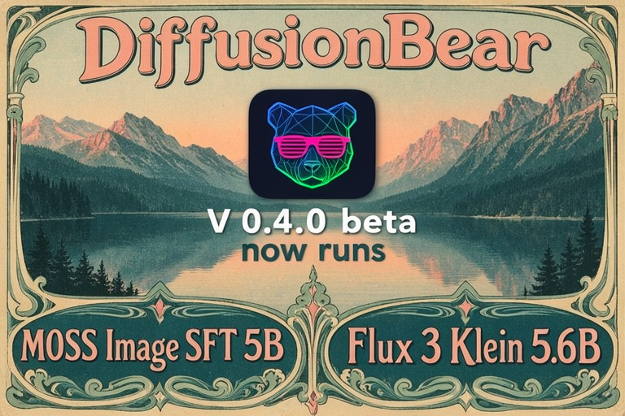
</p>

<h1 align="center">DiffusionBear</h1>

<p align="center"><strong>v0.4.0</strong> &nbsp;·&nbsp; a local-first image generation studio for Apple Silicon</p>

<p align="center">
  <a href="https://www.diffusionbear.com"><strong>Website</strong></a> &nbsp;·&nbsp;
  <a href="https://x.com/DiffusionBear"><strong>x.com/DiffusionBear</strong></a> &nbsp;·&nbsp;
  <a href="https://diffusionbear.com/discord"><strong>Discord</strong></a>
</p>

---

**DiffusionBear** runs open-weight diffusion models on your own Mac. Generation,
prompt enhancement, LoRA management and the gallery all happen on the machine in
front of you: the API listens on `127.0.0.1` (8001, stepping up by 1024 if
something else already owns it), model weights are fetched once into a local
store, and nothing is uploaded anywhere. No account, no cloud, no per-image
billing.

It is built on Apple's [MLX](https://github.com/ml-explore/mlx) framework, so it is
**Apple Silicon only**. There is no CUDA or CPU path — MLX is macOS/Metal
exclusive.

*Formerly called **MLX-Diffusion**; renamed in October 2026. The old repository
URL still redirects.*

Made by **[Ouinche](https://www.ouinche.com)** — follow on X:
**[x.com/DiffusionBear](https://x.com/DiffusionBear)** — heavily coded by AI
(Gemini, 0xAlpha, Big Pickle) — released under the [MIT licence](LICENSE).

---

## What's new in v0.4.0 (beta)

- **Expanded 12+ Model Lineup Across 8 Families:**
  - **SDXL (and its derivatives):** Juggernaut XL Lightning, RealVisXL V5.0 Lightning, RealVisXL V5.0 (Hyper-SD), Juggernaut XI v11, plus any custom single-file SDXL, Pony, or Illustrious `.safetensors` checkpoint (auto-converted up to 50 steps, with adjustable **CLIP Skip**).
  - **FLUX.1:** `FLUX.1-schnell` (4-step flow-matching with full FLUX.1 LoRA support and fast-VAE decode).
  - **FLUX.2:** `FLUX.2-klein 4B` and `FLUX.2-klein 9B` (4-step distilled DiT with up to 10 reference images and generative fill).
  - **FLUX.3:** `FLUX.3-klein 5.6B` (16-step flow-matching distilled engine, up to 10 reference images, and interactive **Virtual Boxes** spatial layout).
  - **MOSS-Image:** `MOSS-Image SFT 5B` (and `Base 5B`) with interactive **Virtual Boxes** and built-in **4-step (`⚡ DMD 4`) and 8-step (`⚡ DMD 8`) DMD step-distillation** adapters that finish in ~1–3 minutes instead of 30 minutes.
  - **Qwen-Image:** `Qwen-Image-2.1` and `Qwen-Image-Turbo-2.1` (8-step distilled variant).
  - **Krea 2:** `Krea 2 Turbo 13B` (with persistent Q4 text-encoder disk cache eliminating the 7.5 GB bf16 spike).
  - **Z-Image:** `Z-Image-Turbo 6B` (fast 6–8 step generation with sharp geometry).
- **Virtual Boxes on the Studio Canvas:** Draw, resize, and label color-coded spatial bounding boxes right on the canvas for **FLUX.3-klein 5.6B** and **MOSS-Image SFT 5B** to position subjects, characters, and exact poster typography without ControlNet.
- **Smart 16 GB Unified Memory Management:** Engineered so 16 GB Apple Silicon Macs run massive models smoothly without crashing — the local Prompt Enhancer automatically unloads before generation (**saving 1.2 GB**), 512px cosine-blended VAE tiling cuts 1024×1024 decode spikes by **4.5 GB**, MOSS uses a custom **MLX q8-g64 text encoder (~2.2 GB)** instead of a 7.5 GB bf16 one, the GPU wired budget is derived automatically (`min(68% of unified memory, Apple's recommended working set)`), and idle engines release their weights after 5 minutes.
- **Gallery Favorites & Privacy Card Blur:** Filter your best images with one-click **☆ Favorites**, and toggle **Blurred** privacy overlays on individual gallery cards (click to reveal).
- **Custom Python Samplers:** Declare your own sampler from a local `.py` file or URL in the Parameters tab; it appears with a ★ in the sampler menu while the built-in default sampler stays protected.
- **DiffusionBee & Draw Things Local Library Import:** Browse and import models and LoRAs already downloaded by **DiffusionBee** (`.tdict`) and **Draw Things** with a strict read-only guarantee.

---

## Install the App & First-Launch Gatekeeper Guide

`DiffusionBear.app` is a self-contained macOS application: it bundles the backend, two relocatable Python/MLX runtimes, and the studio interface inside one `.app`. **You do not need to install Python, Node, Xcode, or Homebrew.**

**[⬇ Download DiffusionBear v0.4.0 for macOS (Apple Silicon)](https://github.com/OuincheWinch/DiffusionBear/releases/download/v0.4.0/DiffusionBear-0.4.0-arm64.zip)** &nbsp;·&nbsp; [v0.4.0 Release Notes & Checksums](https://github.com/OuincheWinch/DiffusionBear/releases/tag/v0.4.0)

| | Detail |
|---|---|
| **Requires** | An Apple Silicon Mac (M1 / M2 / M3 / M4), **macOS 26.2 or later**, 16 GB unified memory recommended. |
| **Your files** | Settings, gallery, LoRA registry, and model store live in `~/Library/Application Support/DiffusionBear`, never inside the app bundle. To put the store on an external drive, write an absolute path into `~/Library/Application Support/DiffusionBear/store_path`. |
| **Model weights** | Downloaded on first use from Hugging Face or [Civitai](https://civitai.red/?ref_code=88C8VEBA) into your local store. After that, the app works 100% offline. |

### 🍎 How to Open on First Launch (macOS Gatekeeper Bypass)

Because DiffusionBear is a free, open-source project signed ad-hoc (without a paid Apple Developer ID notarization certificate), macOS Gatekeeper pauses the very first double-click of a downloaded copy with this dialog:

<p align="center">
  
</p>

> **"DiffusionBear" Not Opened** — *Apple could not verify "DiffusionBear" is free of malware that may harm your Mac or compromise your privacy.*

**Follow this one-time 60-second procedure:**

1. **Unzip and move to `/Applications`:** Unzip `DiffusionBear-0.4.0-arm64.zip` and drag **`DiffusionBear.app`** into your **/Applications** folder *(do not launch it from `~/Downloads` or inside the zip)*.
2. **Bypass Gatekeeper (choose Option A or Option B):**
   * **Option A — Fastest (Terminal 1-Liner):** Open **Terminal.app**, paste this command, and press Return:
     ```bash
     xattr -cr /Applications/DiffusionBear.app
     ```
     Then double-click **`DiffusionBear.app`** in `/Applications` — it opens right away!
   * **Option B — No Terminal (System Settings GUI):**
     1. Click **Done** on the Gatekeeper dialog.
     2. Open **System Settings → Privacy & Security**.
     3. Scroll down to the **Security** section (*"DiffusionBear was blocked to protect your Mac"*).
     4. Click **Open Anyway**, authenticate with Touch ID or your password, and click **Open**.

Once authorized, macOS remembers your choice and **never shows the alert again**.

---

## Supported models

**Twelve+ checkpoints across eight families**, 4-bit quantised and memory-tuned for 16 GB of unified memory. Switching engines swaps weights on demand rather than keeping everything resident.

| Model | Family | Default steps | What it supports |
|---|---|---|---|
| **SDXL & Derivatives** *(Juggernaut XL Lightning, RealVisXL V5.0 Lightning / Hyper-SD, Juggernaut XI v11, Custom SDXL / Pony / Illustrious)* | SDXL | 4–50 | Ultra-fast 4-step Lightning (~9s) or full 20–50 step custom `.safetensors` checkpoints (auto-converted), negative prompts, sampler picker, CLIP Skip, DeepCache, and TAESD fast decode. |
| **FLUX.1-schnell** | FLUX.1 | 4 | Classic 4-step rectified flow, 1 reference image, FLUX.1 LoRAs, and fast-VAE decode. |
| **FLUX.2-klein 4B** | FLUX.2 | 4 | Up to 10 reference images, FLUX.2 LoRAs, and generative fill. Guidance-distilled (no negative prompt). |
| **FLUX.2-klein 9B** | FLUX.2 | 4 | 9-billion-parameter flagship DiT with up to 10 reference images, LoRAs, and superior detail. |
| **FLUX.3-klein 5.6B** | FLUX.3 | 16 | **New in v0.4.0:** 16-step flow-matching distilled, up to 10 reference images, and interactive **Virtual Boxes** on the Studio Canvas. |
| **MOSS-Image SFT 5B** *(+ Base 5B)* | MOSS | 4–8 (DMD) / 25 | **New in v0.4.0:** Interactive **Virtual Boxes**, reference image, LoRAs, MLX q8-g64 text encoder, and automatic **4-step (`⚡ DMD 4`) / 8-step (`⚡ DMD 8`)** distillation adapters. |
| **Qwen-Image-2.1** | Qwen-Image | 25 | 7B single-stream DiT with Qwen3-VL text encoder, 1 reference image, and negative prompts. |
| **Qwen-Image-Turbo-2.1** | Qwen-Image | 8 | **New in v0.4.0:** 8-step distilled Qwen-Image 2.1 variant for fast generation on 16 GB Macs. |
| **Krea 2 Turbo 13B** | Krea 2 | 4–8 | 13B photorealistic engine with 1 reference image, LoRAs, persistent Q4 text-encoder cache, and auto-applied 4-step distilled LoRA. |
| **Z-Image-Turbo 6B** | Z-Image | 6–8 | Compact 6B engine with 1 reference image, LoRAs, fast VAE, and crisp architectural geometry. |

**Bring any SDXL, Pony, or Illustrious checkpoint you own:** single-file Civitai `.safetensors` checkpoints are converted in place, unlisted models can be onboarded from a local folder or your Hugging Face cache, and the app also browses models and LoRAs already downloaded by **Draw Things** and **DiffusionBee** (strictly read-only).

---

## Screenshots (v0.4.0)

Captured from **v0.4.0 (beta)** on a MacBook Pro (Apple M1, 16 GB) — dark and light Studio themes.

| FLUX.3 Klein 5.6B + Virtual Boxes (Dark) | FLUX.3 Klein 5.6B + Virtual Boxes (Light) |
|---|---|
| 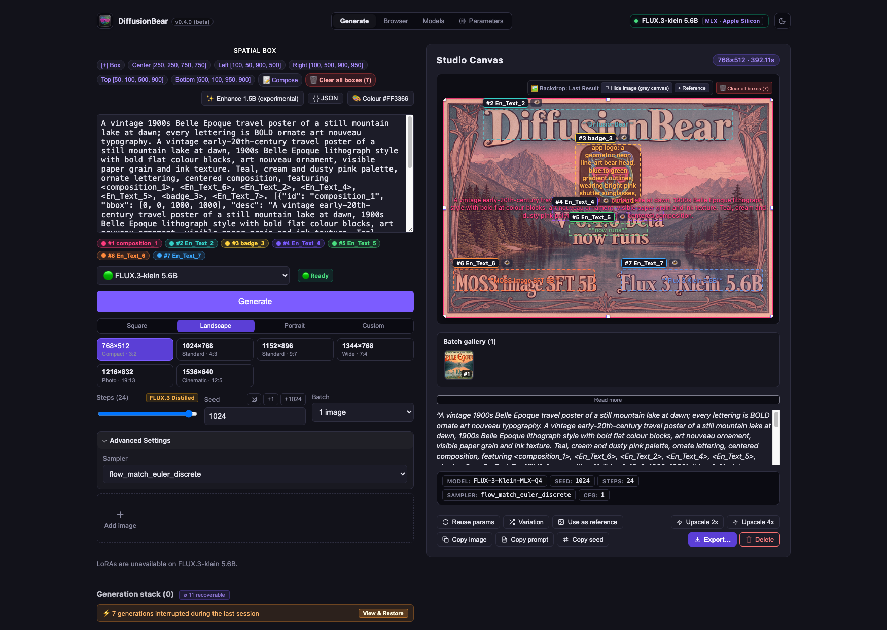 | 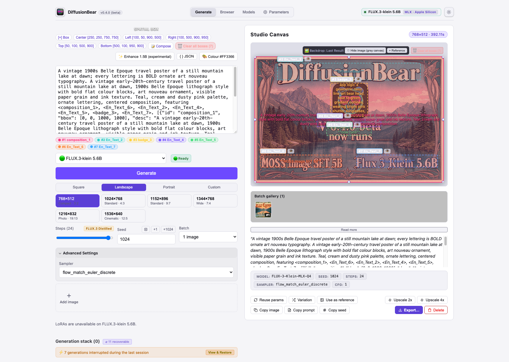 |

| MOSS-Image SFT 5B + 4/8-Step DMD Distillation | Browser / Gallery with Favorites & Privacy Blur |
|---|---|
| 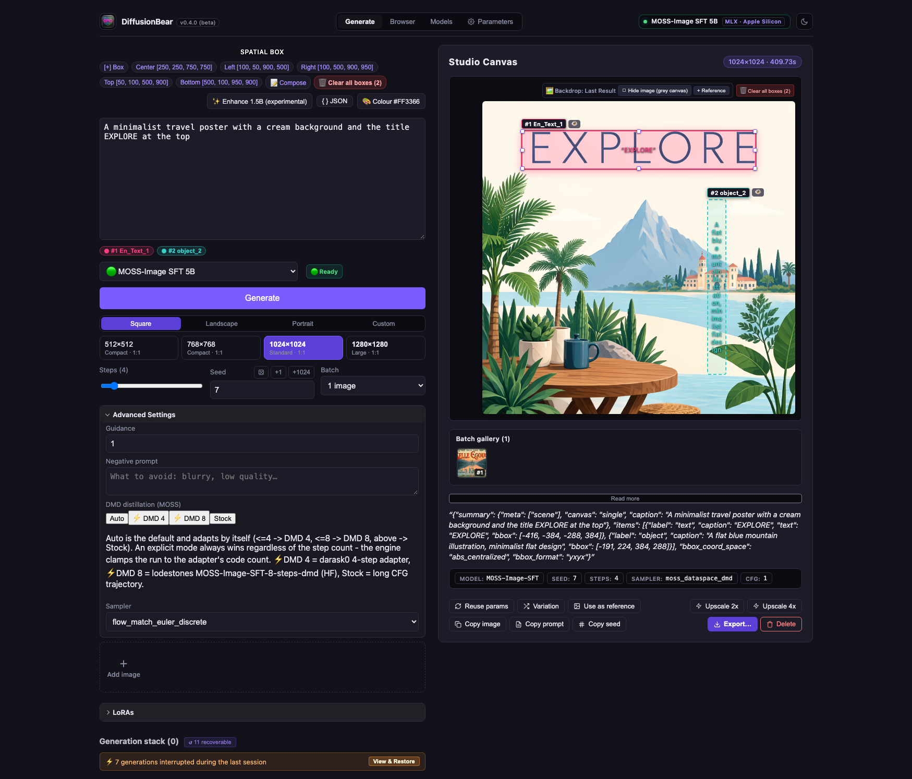 | 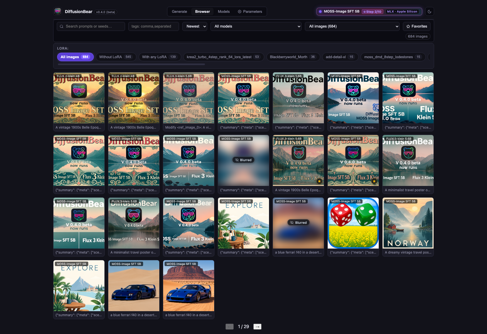 |

| Models: Browse, Download & Manage | Models: DiffusionBee & Draw Things Import |
|---|---|
| 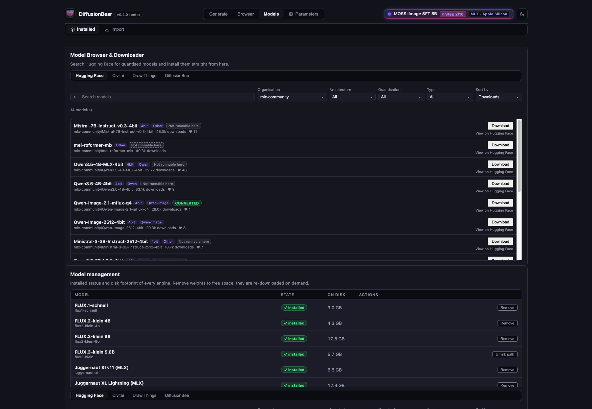 | 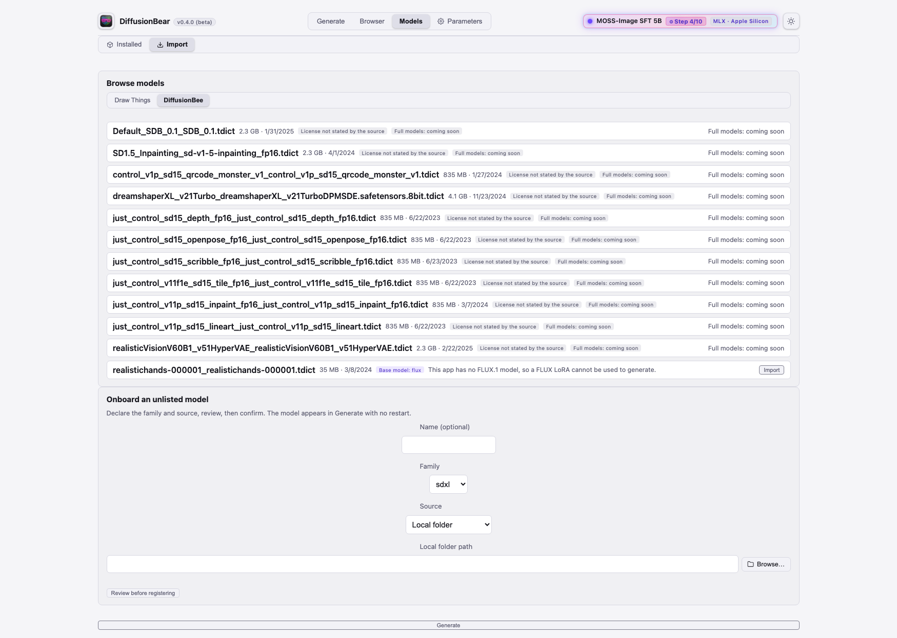 |

| Parameters: Smart Memory & Custom Samplers | Dual Local Prompt Enhancer (Prose & JSON) |
|---|---|
| 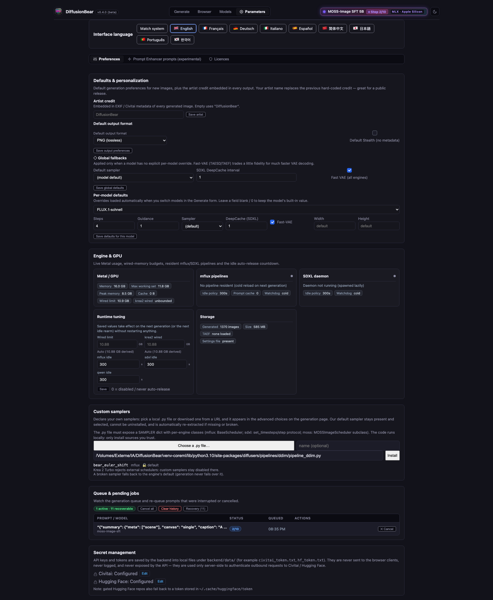 | 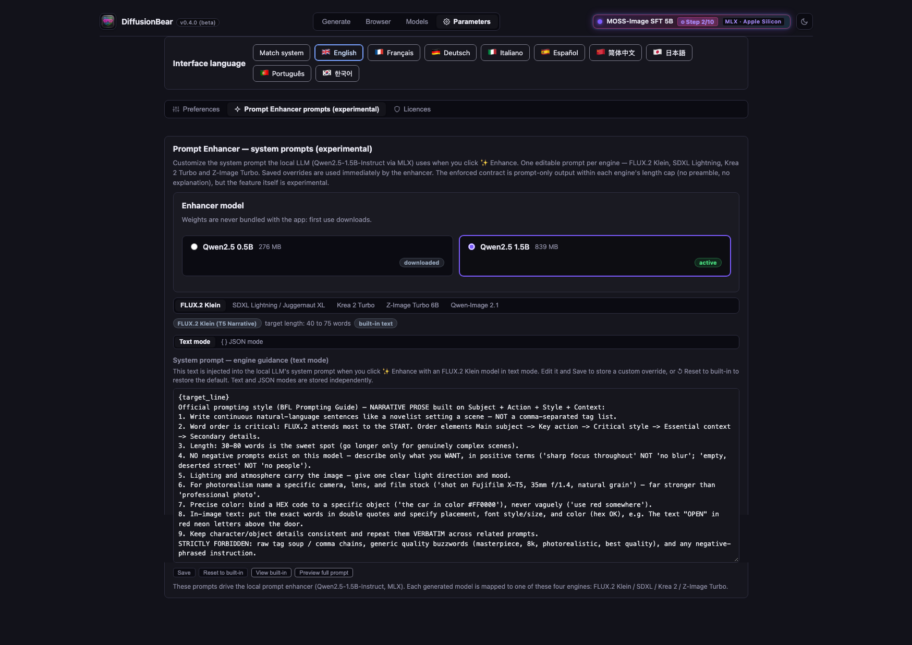 |

---

## Virtual boxes — place things where you want them

Three engines (FLUX.3-klein, MOSS-Image SFT and Base) accept **spatial boxes**:
instead of hoping the model puts the cat in the right corner, you draw a box on
the Studio Canvas and say what belongs inside it. The canvas can show a
reference image as a backdrop, so you compose over the actual picture you want.

- **SPATIAL BOX panel:** presets (Center / Left / Right / Top / Bottom / full
  frame), free boxes you drag on the canvas, and a live count.
- **Compose** turns your caption + boxes into the layout description the engine
  understands; **JSON** shows exactly what will be sent.
- **Reference backdrops:** overlay any gallery image or reference behind the
  boxes, hide it or remove it at will.
- The layout travels with the generation metadata, so reusing parameters
  reproduces the composition.

For FLUX.2-klein, the equivalent is **generative fill**: paint a mask on a
gallery image and regenerate just that region.

---

## Memory management, quietly handled

Running 4–13 B parameter models on a 16 GB Mac is a memory-budget problem. The
app manages it; you watch (Parameters → Engine & GPU) rather than tune:

- **Auto wired-limit.** Each engine's GPU wired budget is derived from your
  machine — `min(68% of unified memory, Apple's recommended working set)`, about
  **10.9 GB on a 16 GB Mac**. An explicit number you set still wins; `0` means
  unbounded.
- **Idle auto-release.** Resident pipelines (a full FLUX/Krea2 pipeline is
  ~10 GB) are released after **5 minutes of inactivity** (300 s default,
  tunable per engine; `0` = never release). Reloading afterwards costs a few
  seconds, not minutes — macOS keeps the weight files in its file cache.
- **Quantised everything.** Weights are 4-bit by default; the MOSS text encoder
  is swapped for the app's own **MLX q8g64 build (~2.2 GB)** and the Krea 2
  encoder is quantised once and persisted, so later sessions skip both the
  7.5 GB bf16 load and the quantisation pass.
- **Live panel.** Metal memory in use, peak, the wired limits, which pipelines
  are resident, and the idle countdowns — all visible, nothing hidden.
- **Storage cleanup.** The Parameters tab reports generated-image size, TAESD
  state and settings, and the Models tab clears per-repo Hugging Face cache
  entries to reclaim disk space.

### MOSS-Image DMD distillation (default behaviour)

Each MOSS DMD kit is three files that only work together: a projection **LoRA**,
a distilled fp32 **time embedding**, and a **dataspace** file holding the
CFG-free step schedule. The **DMD distillation** control has four positions:

| Mode | Adapter used | Schedule |
|---|---|---|
| **Auto** *(default)* | follows the step slider: ≤4 steps → DMD 4, ≤8 → DMD 8, above → stock | stock CFG trajectory above 8 steps |
| **⚡ DMD 4** | darask0's 4-step kit (`moss_distill/darask0-4step`) | CFG-free, engine clamps the run to the 4 codes |
| **⚡ DMD 8** | lodestones' 8-step kit ([`lodestones/MOSS-Image-SFT-8-steps-dmd`](https://huggingface.co/lodestones/MOSS-Image-SFT-8-steps-dmd), Apache-2.0) | CFG-free, engine clamps the run to the 8 codes |
| **Stock** | none | full CFG trajectory at the requested steps (~20–45 min) |

Forcing DMD 4 or DMD 8 at a higher requested step count still runs the 4- or
8-step codes (the engine clamps the loop and drops CFG, which has no effect on
the dataspace schedule). On a 16 GB M1 that is roughly **1 min (4 steps)** /
**3 min (8 steps)** at 768×512, against 20–45 min stock. If a kit is missing
the app **downloads it automatically** when the run needs it (resumable); with
no network it falls back to the stock trajectory rather than failing.

---

## Local by design

- **Generation runs on the Metal GPU** through MLX (`mflux` for the
  flow-matching families, a native MLX daemon for SDXL, dedicated engines for
  MOSS and Qwen). Weights are 4-bit so a 4–13 B model fits a 16 GB machine.
- **The prompt enhancer is a local LLM too** (Qwen2.5 0.5B or 1.5B, MLX) —
  rewriting a prompt never leaves the machine.
- **No telemetry, no analytics, no network calls at generation time.** Once the
  weights are cached the app works fully offline.
- Tokens ([Civitai](https://civitai.red/?ref_code=88C8VEBA) API key, Hugging
  Face token — both optional, both only for smoother downloads of gated or
  rate-limited repos) are stored on your disk and sent only to the service they
  belong to.

Unified memory is why this works at all on a 16 GB machine: the CPU and GPU
share one pool, so a quantised model stays resident with no CPU↔GPU copying —
exactly what MLX is built to exploit.

---

## Benchmarks

Measured on a **2021 MacBook Pro M1 (16 GB)** — the reference machine this
project is tuned for. A **September 2026 snapshot** (293 timed studio
generations): read it as a record of that build. Within each bucket the fastest
and slowest 5% are excluded before mean/median, so load spikes do not skew the
numbers.

| Model | Resolution | Steps | Median | Range |
|---|---|---|---|---|
| **Juggernaut XL Lightning (SDXL)** | 512×768 | 4 | **9 s** | 9 – 11 s |
| **RealVisXL V5.0 Lightning (SDXL)** | 512×512 | 6 | 22 s | 20 – 27 s |
| **Juggernaut XL Lightning (SDXL)** | 1024×1024 | 4 | 1:06 min | — |
| **FLUX.2-klein 4B** | 512×512 | 4 | 48 s | 38 – 51 s |
| **FLUX.2-klein 4B** | 768×768 | 4 | 1:16 min | 1:14 – 1:19 min |
| **FLUX.2-klein 4B** | 1024×1024 | 4 | 2:03 min | — |
| **FLUX.2-klein 9B** | 512×768 | 4 | 1:51 min | — |
| **RealVisXL V5.0 (SDXL)** | 512×768 | 8 | 55 s | 46 s – 1:21 min |
| **Z-Image Turbo 6B** | 512×512 | 8 | 1:43 min | 1:15 – 2:13 min |
| **Krea 2 Turbo 13B** | 512×512 | 8 | 2:44 min | 1:38 – 3:36 min |
| **Qwen-Image 2.1** | 512×768 | 20 | 7:36 min | 7:10 – 8:05 min |

FLUX.3-klein and the MOSS DMD paths postdate this snapshot; DMD 4 at 768×512
runs in about a minute on the same machine. The full table with trimmed means
and the repeatability suite lives in the September run records.

## Model vs model — visual arena

Head-to-head comparisons on original, royalty-free scenes. Each duel plays
right here as a muted auto-wiping divider video; for the **draggable** version,
open
[ouinche.com/mlx-diffusion-yet-another-open-source-image-generator-on-apple-silicon](https://www.ouinche.com/mlx-diffusion-yet-another-open-source-image-generator-on-apple-silicon/).
GitHub strips JavaScript from READMEs, so a slider cannot render on the repo
page — the moving divider is the closest thing that does.

### FLUX.2-klein 4B vs Z-Image Turbo 6B — "Rustic Sourdough" (512×768)

<video muted loop autoplay playsinline controls poster="docs/model-arena/images/flux2_klein_sourdough.png">
  <source src="docs/model-arena/images/arena_flux2_vs_zimage.mp4" type="video/mp4">
</video>

### FLUX.2-klein 4B vs Juggernaut XL Lightning — "Modern Glass Villa" (512×768)

<video muted loop autoplay playsinline controls poster="docs/model-arena/images/flux2_klein_villa.png">
  <source src="docs/model-arena/images/arena_flux2_vs_juggernaut.mp4" type="video/mp4">
</video>

### FLUX.2-klein 4B vs Krea 2 Turbo 13B — "Snow Leopard" (512×768)

<video muted loop autoplay playsinline controls poster="docs/model-arena/images/flux2_klein_leopard.png">
  <source src="docs/model-arena/images/arena_flux2_vs_krea.mp4" type="video/mp4">
</video>

| FLUX.2-klein 4B | Z-Image Turbo 6B / Juggernaut XL / Krea 2 Turbo |
|---|---|
| 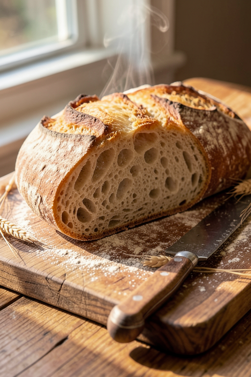 | 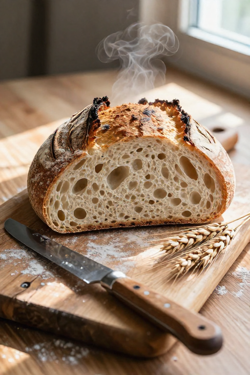 · 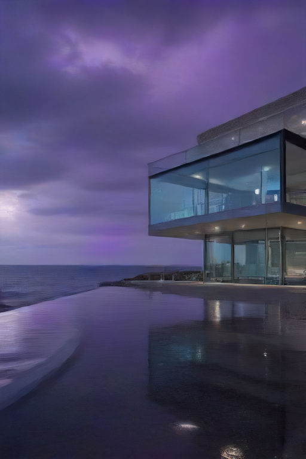 ·  |

---

## Everything else the app does

- **Model browser & downloader** — search Hugging Face and Civitai side by side,
  classify, download with progress/speed/cancel, direct URLs, and convert
  single-file Civitai SDXL checkpoints to runnable diffusers directories
  out-of-process.
- **Reference images** — FLUX.2/FLUX.3 take up to 10 (`Image 1`, `Image 2`, …),
  Z-Image, Krea 2, Qwen and FLUX.1 take one; studio-canvas backdrops on the
  box-capable engines.
- **LoRA manager** — drag a `.safetensors` in or import from Civitai; FLUX.1,
  FLUX.2, FLUX.3, Z-Image, Krea 2 and SDXL (rank-concat stacking) formats;
  trigger words become clickable chips; a LoRA that does not fit the selected
  model is refused *before* generating, with the mismatch named.
- **Prompt enhancer** — local Qwen2.5 0.5B/1.5B rewrites your prompt per engine
  family, prose or JSON, with editable system prompts and trigger-word
  preservation.
- **Custom samplers** — from a local `.py` file or a URL; protected built-in
  default; a broken custom sampler falls back to the engine default, never to a
  failed generation.
- **Queue & recovery** — one generation at a time behind a FIFO worker; a job
  interrupted by a crash or quit is recoverable and re-queueable.
- **Gallery** — tags, search, favourites, one-click Use-as-Reference, 2×/4×
  Lanczos upscaling, Civitai-compliant PNG metadata (with a stealth mode that
  omits it all).
- **Interface** in English, French, German, Italian, Spanish, Simplified
  Chinese, Japanese, Portuguese and Korean.
- **⚖ Licences tab** — the licence of every bundled package and every supported
  model, in one place.

---

## For developers

Everything above is the app; this section is the minimum needed to build and
run it from source. An Apple Silicon Mac, Python 3.10 + 3.14 and Node.js 18+
are required.

**Build the app** (three scripts, in order — output lands in
`packaging/dist/DiffusionBear.app`; `INSTALL_APP=1` also installs it to
/Applications):

```bash
packaging/build_runtime_venv.sh   # main runtime: Python 3.10 + mflux
packaging/build_sdxl_venv.sh      # SDXL engine runtime: Python 3.14 + mlx_diffuser
packaging/build_app.sh            # assembles and ad-hoc signs DiffusionBear.app
```

The scripts audit their own output and fail the build on absolute build paths,
unrelocatable interpreters, weights or credential-shaped files. Install with the
build script's own install step — a hand `cp -R` of a signed bundle is known to
silently skip files.

**Run from a checkout** (development):

```bash
python3 -m venv venv && python3 -m venv venv-sdxl
./venv/bin/python -m pip install -r backend/requirements.txt
./venv-sdxl/bin/python -m pip install -r backend/requirements-sdxl.txt
cd frontend && npm install && cd ..
./run.sh        # backend on 8001, Vite on 5174, opens the UI
```

Dev mode is `./dev-backend.sh` plus `cd frontend && npm run dev`; lint and build
are `npm run lint` and `npm run build`. Backend tests run with
`./venv/bin/python backend/test_<name>.py`. Ports 8001/5174 are deliberate — do
not "fix" them.

**Public-source export.** `packaging/export_public.sh` builds a filtered tree
(internal docs, tests, scratch excluded), audits it for local paths,
credential-shaped files and weights, and refuses to ship anything unsafe;
`--push` publishes to the public repository.

---

## Documentation

- [CHANGELOG.md](CHANGELOG.md) — what changed in each release
- [RELEASE_NOTES.md](RELEASE_NOTES.md) — release notes and the Gatekeeper guide
- [CONTRIBUTING.md](CONTRIBUTING.md) — how to build, verify and propose a change
- [SECURITY.md](SECURITY.md) — privacy posture and vulnerability reporting
- [USER_GUIDE.md](USER_GUIDE.md) — full usage guide
- [docs/VirtualBox.md](docs/VirtualBox.md) — run DiffusionBear inside VirtualBox on non-Apple machines

---

## Author and AI-assisted development

DiffusionBear is written and maintained by **[Ouinche](https://www.ouinche.com)**
(<https://github.com/OuincheWinch>). Follow on X:
**[x.com/DiffusionBear](https://x.com/DiffusionBear)**.

DiffusionBear is **heavily coded by AI** — Gemini, 0xAlpha and Big Pickle do a
large share of the writing. That is a deliberate choice, not an accident.

## Security

Please **do not open a public issue** for a security problem. Use GitHub's
[private vulnerability report](https://github.com/OuincheWinch/DiffusionBear/security/advisories/new),
or email the author with the subject `[DiffusionBear security]`.
Scope and the privacy posture are in [SECURITY.md](SECURITY.md).

## License

[MIT](LICENSE) — Copyright © 2026 **[Ouinche](https://www.ouinche.com)**. This
covers the project's source code only. Model weights carry their own terms
(FLUX.2/FLUX.3 are Black Forest Labs non-commercial; the Juggernaut and
RealVisXL checkpoints are non-commercial too), and none of them are
redistributed here — they are downloaded from Hugging Face or
[Civitai](https://civitai.red/?ref_code=88C8VEBA) on first use. The app shows
the full per-package and per-model licences in its **⚖ Licences** tab.
