<p align="center">
  <a href="https://github.com/OuincheWinch/DiffusionBear/releases/tag/v0.5.0">
    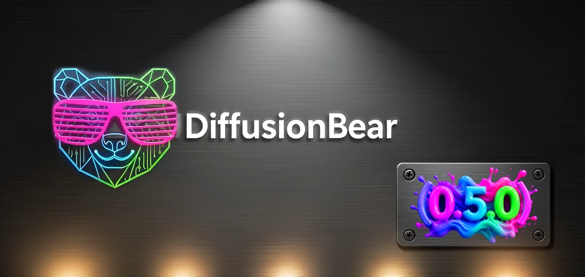
  </a>
</p>

<h1 align="center">DiffusionBear</h1>

<p align="center"><strong>v0.5.0</strong> &nbsp;·&nbsp; a local-first image generation studio for Apple Silicon</p>

<p align="center">
  <a href="https://www.diffusionbear.com"><strong>Website</strong></a> &nbsp;·&nbsp;
  <a href="https://www.diffusionbear.com/agentic-api.html"><strong>Agentic API</strong></a> &nbsp;·&nbsp;
  <a href="https://www.youtube.com/watch?v=D6Nq4XPxHf8&t=1s"><strong>Video tutorial</strong></a> &nbsp;·&nbsp;
  <a href="https://x.com/DiffusionBear"><strong>x.com/DiffusionBear</strong></a> &nbsp;·&nbsp;
  <a href="https://diffusionbear.com/discord"><strong>Discord</strong></a>
</p>

---

**DiffusionBear** A free macOS studio that runs SDXL (and its derivatives), FLUX.1, FLUX.2 Klein 4B/9B, FLUX.3 Klein 5.6B, MOSS-Image SFT 5B, Qwen-Image-2.1 & Edit & Turbo, Krea 2 Turbo, Z-Image-Turbo, and Bria FIBO 2.0 Edit Turbo on your Mac's own Metal GPU. No account, no cloud, no per-image
billing.

It is built on Apple's [MLX](https://github.com/ml-explore/mlx) framework, so it is
**Apple Silicon only**. There is no CUDA or CPU path — MLX is macOS/Metal
exclusive.


Made by **[Ouinche](https://www.ouinche.com)** — follow on X:
**[x.com/DiffusionBear](https://x.com/DiffusionBear)** 
— released under the [MIT licence](LICENSE).

---

## What's new in v0.5.0

- **Full deletion of PyTorch & trimmed MLX bundle (`-52%` `.app`, `-45%` `.zip`):** **1.3 GB → 615 MB**
  `.app` (**396.7 MB → 217.1 MB** arm64 `.zip`). `torch`, `torchvision`,
  `torchaudio`, `diffusers`, and `accelerate` are 100% deleted from the
  packaged `.app` and default runtime. Only the exact runtime modules needed are
  bundled (`mlx`, `safetensors`, NumPy, `transformers`, `tokenizers`, and `--no-deps` `mlx-vlm`), compiled with `0` build warnings.
- **Rebuilt 3-Stage / 4-Stage MLX Generation Pipeline:** replaced the monolithic
  pipeline with a strict sequential memory lifecycle so **only one heavy model
  tree is resident in Unified Memory at a time**:
  - **3-stage (Text-to-Image):** **Encode** (Text Encoder → embeddings → evict) → **Generate** (DiT/UNet → latents → evict) → **Decode** (VAE / fast TAEF mini-VAE → pixels → evict).
  - **4-stage (Reference / img2img / Edit):** adds **Stage 1/4 Reference Encode** at the start — loading the VAE (or Vision-Language encoder), encoding reference image(s) into latent space (`image_latents` + `image_latent_ids`), and evicting the reference encoder before prompt encoding, denoising with injected reference latents, and final VAE decoding.
- **Generation speed (Apple M1 16 GB, 512×768 medians):** 19-config / 209-run suite
  finishes in **5h 24m 26s** (**-58.5%** vs prior 13h 01m 38s reference, **-4.7%** step-matched):
  - **MOSS-Image SFT 5B (4s DMD):** **83.57 s** (**-96.7%** vs 25-step stock)
  - **Qwen-Image 2.1 (2s + DMD2):** **46.77 s** (**-32.0%**) · **Turbo 8s:** **158.64 s** (**-19.4%**)
  - **FLUX.1-schnell (4s):** **74.22 s** (**-16.5%**) · **RealVisXL V5.0 (8s):** **38.78 s** (**-16.0%**)
  - **Juggernaut XL Lightning (4s):** **8.80 s** (**-9.9%**) · **Bria FIBO 2.0 Edit Turbo (4s):** **93.68 s** (**-8.3%**)
  - **FLUX.2-klein 9B (4s):** **96.54 s** (**-8.0%**) · **FLUX.2-klein 4B (4s):** **44.09 s** (**-7.2%**)
  - **SDXL persistent q4 cache:** warm SDXL + LoRA reloads drop from ~34 s to ~3.45 s via staged TE/UNet eviction and persistent prequantized artifacts.
- **Kromoss 5B (4-bit MLX) + 8-step Accelerator LoRA:** added support for **Kromoss 5B** (`Ouinche/kromoss-mlx-q4`, a 4-bit MLX distillation of MOSS / `lodestones/Kromoss`), running natively on the pure-MLX MOSS engine with its automatic **8-step DMD2 Accelerator LoRA** (**129.43 s median** at 512×768).
- **Canonical Model Families & Qwen 2.5 Prompt Enhancers:** every architecture now belongs to its own canonical family (`sdxl`, `flux1`, `flux2`, `flux3`, `krea2`, `z-image`, `qwen`, `moss`, `fibo2`) with a dedicated local **Qwen 2.5** (0.5B / 1.5B MLX) prompt-enhancer profile.
- **Qwen-Image 2.1 & Turbo Alpha Channel (RGBA Transparency):** added a toggle in **Advanced Settings** to force 4th-channel alpha transparency at generation time, with checkerboard preview across Canvas, Browser, and Image Cards.
- **First-run model SHA-256 verification & partial repair:** hashes installed built-in models once on first launch against SHA-256 manifests embedded in the binary (custom user models untouched), flags mismatches from legacy upgrades, and offers shard-level partial or full redownload — also available anytime on the **Models** tab.
- **Open Agentic REST API & Remote Browser Access (`http://127.0.0.1:8001`):**
  drive any installed model, LoRA, Reference Edit, mask, or Virtual Box
  programmatically from local or remote AI agents (`Claude Code`, `Cursor`, `Antigravity`) or scripts — **no cloud tokens, no subscriptions, zero per-image billing** — or generate remotely using **only one web browser** (`Chrome`, `Firefox`, `Opera`, `Safari` on Mac/iPhone/iPad) with managed `dbk_...` keys (`SHA-256`), `Authorization: Bearer` / `X-API-Key`, wildcard bind fail-safe, and `429` queue rate limits. Interactive guide at
  **[diffusionbear.com/agentic-api.html](https://www.diffusionbear.com/agentic-api.html)**
  and step-by-step setup in **[docs/parameters-api-guide.md](docs/parameters-api-guide.md)**.

## What's new in v0.4.5 (beta)

- **Native MLX SDXL engine — rewritten from scratch:** the `mlx_diffuser` dependency is gone. We now own the MLX UNet, dual CLIP encoders, VAE decoder, schedulers, LoRA stack, 4/8-bit quantization, resident text encoders and TAESD. Removing the second `venv-sdxl` runtime cut the app bundle from **1.7 GB to 1.3 GB** and the release zip from **510 MB to 385 MB**.
- **Long prompts and mandatory adapters:** SDXL/Pony prompts are split across 77-token CLIP windows instead of silently truncated; Qwen DMD2 and MOSS DMD adapters auto-restore when missing; Qwen 2.1 reference images now warn to use Qwen-Image Edit for instruction edits.
- **Qwen base self-healing:** the base pack now supplies its own tokenizer/scheduler/model_index instead of borrowing another Qwen install; incomplete component weights fail with a clear re-download error instead of rendering a texture.
- **Licence display and validation reviewed.**
- **LoRA management polished, including the Krea 2 Turbo LoRA recipe.**
- **MOSS-Image batching fixed:** the second image in a cached batch no longer fails during VAE decode.
- **MOSS LoRAs fixed:** detected/registered as MOSS, selectable in the architecture dropdown, and the real tensor layout now overrides Civitai metadata.
- **Pony Diffusion V6 XL:** corrected to a working Diffusers download source.
- **Z-Image / FLUX samplers:** Euler now maps to the flow-match scheduler instead of the Krea 2 scheduler.
- **French model sizes:** shown as `GB` instead of `Go`.
- **Qwen-Image integration refined.**
- **Minor bug fixes.**

## What's new in v0.4.4 (beta)

- **Qwen-Image-2.1 Edit support**, with Qwen-VL reference conditioning and the Edit-specific prompt path.
- **Qwen-Image-2.1 and Krea 2 Turbo:** Hugging Face depot repackaging.
- **Linoy Tsaban 2-step DMD2 Distill LoRA for Qwen-Image 2.1:** high-speed 2-step generation (~33–50s after initial compile) with automatic 2-step/CFG-1 tuning.
- **Gallery Reference Image Filtering:** isolate generations made with visual reference conditioning.
- **Website and documentation upgrades**, typography fixes, unified navigation, and minor bug fixes.

## What's new in v0.4.3 (beta)

- **Browser page revamp:** navigate pages with `←` / `→` and jump directly to a page number.
- **Memory management tweaks:** large generations are checked against the machine's safe megapixel ceiling before they can trigger a Metal out-of-memory crash.
- **Minor bug fixes.**

## What's new in v0.4.2 (beta)

- **Full support of FIBO 2.0 Edit Turbo MLX 4-bit:** First-ever 4-bit quantized port of Bria AI's state-of-the-art instruction editing model running natively on Apple Silicon via MLX ([Hugging Face: Ouinche/FIBO2-Edit-Turbo-MLX-4bit](https://huggingface.co/Ouinche/FIBO2-Edit-Turbo-MLX-4bit) | [Original Model: briaai/Fibo-2.0-edit-turbo](https://huggingface.co/briaai/Fibo-2.0-edit-turbo)).
- **Text-Guided Reference Edit:** High-fidelity single reference editing with natural language prompts in only 4 denoising steps (~85s on M1).
- **Masked Edit (Precision Inpainting):** Interactive brush painting directly on reference image backdrop in DiffusionBear Studio. Zero variance outside masked area with automated 1.5px Gaussian edge blending and unmasked composite retention.
- **Multiple References (Multimodal In-Context Editing):** Combine up to 4 reference images (e.g., character portrait + specific dress or object) grounded through the integrated 4-bit Qwen3-VL vision-language encoder.
- **3-Stage Sequential Memory Management:** Lazy component lifecycle (Qwen3-VL → DiT Transformer → FLUX.2 VAE) keeping resident VRAM strictly below 6.8 GB on 16 GB Apple Silicon.
- **Visual Showcase & Benchmarks:** Interactive comparison suite, side-by-side comparisons with original Bria outputs, and telemetry report at [diffusionbear.com/fibo.html](https://www.diffusionbear.com/fibo.html).

## What's new in v0.4.1 (beta)

- **SDXL Metal Memory Stabilization:** Systematic Metal buffer clearing and working-set memory management (+51.9% suite-wide speedup, 4.25x faster on Juggernaut XL Lightning down to 9.2s).
- **Generation Pipeline Optimization:** Lossless JIT compilation (`@mx.compile`), sub-second TAESD VAE decoding, and `euler_trailing` timesteps restoring 100% visual parity (&infin; dB PSNR).
- **Interactive 187-Run Benchmark Arena:** Explore all 17 model configurations with our interactive comparison slider at [diffusionbear.com/benchmark.html](https://www.diffusionbear.com/benchmark.html).

## What's new in v0.4.0 (beta)
- **Virtual Boxes on the Studio Canvas:** Draw, resize, and label color-coded spatial bounding boxes right on the canvas for **FLUX.3-klein 5.6B** and **MOSS-Image SFT 5B** to position subjects, characters, and exact poster typography without ControlNet.
- **Smart 16 GB Unified Memory Management:** 
- **Gallery Favorites & Privacy Card Blur:** 
- **Custom Python Samplers:** 
- **DiffusionBee & Draw Things Local Library Import:** if you allow DiffusionBear to read theirs directories
---

## Install the App & First-Launch Gatekeeper Guide

`DiffusionBear.app` is a self-contained macOS application: it bundles the backend, one relocatable Python/MLX runtime, and the studio interface inside one `.app`. **You do not need to install Python, Node, Xcode, or Homebrew.**

**[⬇ Download DiffusionBear for macOS (Apple Silicon)](https://github.com/OuincheWinch/DiffusionBear/releases/download/v0.5.0/DiffusionBear-0.5.0-arm64.zip)** &nbsp;·&nbsp; [v0.5.0 Release Notes & Checksums](https://github.com/OuincheWinch/DiffusionBear/releases/tag/v0.5.0)

| | Detail |
|---|---|
| **Requires** | An Apple Silicon Mac (M1 / M2 / M3 / M4 / M5 / M6), **macOS 26.2 or later**, 16 GB unified memory recommended. |
| **Your files** | Settings, gallery, LoRA registry, and model store live in `~/Library/Application Support/DiffusionBear`. To put the store on an external drive, write an absolute path into `~/Library/Application Support/DiffusionBear/store_path`. |
| **Model weights** | Downloaded on first use from Hugging Face or [Civitai](https://civitai.com/?ref_code=88C8VEBA) into your local store. After that, the app works 100% offline. |
| **Package size** | **217.1 MB** arm64 `.zip` → **615 MB** standalone `.app` (pure MLX, no PyTorch or `diffusers`). |

**0.5.0 SHA-256:** zip `f2d3bf2865fb53ef215cefcaefb331793ef76119a88cb79dabb7ec38c27a94fa` · dmg `4a2ed3eba57378c47a80c4a3b4d15bfa50bc461c8986126c1324d4fd7725ec9b` (all checksums recorded in [packaging/ALL_SHA256SUMS](packaging/ALL_SHA256SUMS)).

### 🍎 How to Open on First Launch (macOS Gatekeeper Bypass)

Because DiffusionBear is a free, open-source project signed ad-hoc (without a paid Apple Developer ID notarization certificate), macOS Gatekeeper pauses the very first double-click of a downloaded copy with this dialog:

<p align="center">
  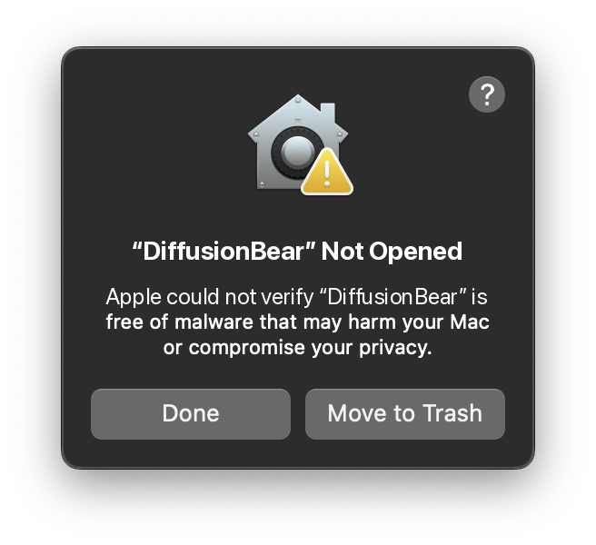
</p>

> **"DiffusionBear" Not Opened** — *Apple could not verify "DiffusionBear" is free of malware that may harm your Mac or compromise your privacy.*

**Follow this one-time 60-second procedure:**

1. **Unzip and move to `/Applications`:** Unzip `DiffusionBear-0.5.0-arm64.zip` and drag **`DiffusionBear.app`** into your **/Applications** folder *(do not launch it from `~/Downloads` or inside the zip)*.
2. **Bypass Gatekeeper (choose Option A or Option B):**
   * **Option A — Fastest (Terminal 1-Liner):** Open **Terminal.app**, paste this command, and press Return:
     ```bash
     xattr -cr /Applications/DiffusionBear.app
     ```
     Then double-click **`DiffusionBear.app`** in `/Applications` — it opens right away!
   * **Option B — No Terminal (System Settings GUI):**
     1. Click **Done** on the Gatekeeper dialog.
     2. Open **System Settings → Privacy & Security**.
     3. Scroll down to the **Security** section (*"DiffusionBear was blocked to protect your Mac"*).
     4. Click **Open Anyway**, authenticate with Touch ID or your password, and click **Open**.

Once authorized, macOS remembers your choice and **never shows the alert again**.

---

## Supported models

**Twelve+ checkpoints across nine families**, 4-bit quantised and memory-tuned for 16 GB of unified memory. Switching engines swaps weights on demand rather than keeping everything resident.

| Model | Family | Default steps | What it supports |
|---|---|---|---|
| **FIBO 2.0 Edit Turbo** | FIBO 2.0 | 4 | Up to 4 reference images, 4-step distilled editing, guidance-free (no negative prompt), and a Qwen3-VL 4B text encoder. |
| **FLUX.1-schnell** | FLUX.1 | 4 | Classic 4-step rectified flow, 1 reference image, FLUX.1 LoRAs, and fast-VAE decode. |
| **FLUX.2-klein 4B** | FLUX.2 | 4 | Up to 10 reference images, FLUX.2 LoRAs, and generative fill. Guidance-distilled (no negative prompt). |
| **FLUX.2-klein 9B** | FLUX.2 | 4 | 9-billion-parameter flagship DiT with up to 10 reference images, LoRAs, and superior detail. |
| **FLUX.3-klein 5.6B** | FLUX.3 | 16 | 16-step flow-matching distilled, up to 10 reference images, and interactive **Virtual Boxes** on the Studio Canvas. |
| **Krea 2 Turbo 13B** | Krea 2 | 4–8 | 13B photorealistic engine with 1 reference image, LoRAs, persistent Q4 text-encoder cache, and auto-applied 4-step distilled LoRA. |
| **Kromoss 5B** | MOSS | 8 | 4-bit MLX distillation of MOSS with automatic **8-step DMD2 Accelerator LoRA** (`8-steps-dmd2-lora.safetensors`), Virtual Boxes, and pure-MLX staged execution. |
| **MOSS-Image SFT 5B** *(+ Base 5B)* | MOSS | 4–8 (DMD) / 25 | Interactive **Virtual Boxes**, reference image, LoRAs, MLX q8-g64 text encoder, and automatic **4-step (`⚡ DMD 4`) / 8-step (`⚡ DMD 8`)** distillation adapters. |
| **Qwen-Image Edit** | Qwen-Image | 8–25 | Instruction-based editing with up to 3 reference images, negative prompts and guidance, plus 8/15/20/25-step presets. No 2-step adapter (the 60-layer edit transformer is incompatible with Qwen-Image 2.1 DMD2). |
| **Qwen-Image-2.1** | Qwen-Image | 2–25 | 7B single-stream DiT with Qwen3-VL text encoder, 1 reference image, negative prompts, optional **RGBA alpha-channel transparency** in Advanced Settings, and an auto-injected **2-step DMD2 LoRA** (`linoyts/Qwen-Image-2.1-DMD2-2steps`, ~33–50 s). |
| **Qwen-Image-Turbo-2.1** | Qwen-Image | 4–8 | 8-step distilled Qwen-Image 2.1 variant for 16 GB Macs, with optional **RGBA alpha-channel transparency** and its own 4-step distillation LoRA. |
| **SDXL & Derivatives** *(Juggernaut XL Lightning, RealVisXL V5.0 Lightning / Hyper-SD, Juggernaut XI v11, Custom SDXL / Pony / Illustrious)* | SDXL | 4–50 | 4-step Lightning (8.80 s) or 20–50 step custom `.safetensors` checkpoints (auto-converted), negative prompts, sampler picker, CLIP Skip, DeepCache, and TAESD fast decode. |
| **Z-Image-Turbo 6B** | Z-Image | 6–8 | Compact 6B engine with 1 reference image, LoRAs, fast VAE, and crisp architectural geometry. |

> **Recommended fast path:** Qwen-Image 2.1 at 2 steps with the `linoyts/Qwen-Image-2.1-DMD2-2steps` LoRA (downloaded automatically on first use, guidance locked to 1.0). Qwen-Image Turbo 2.1 uses its separate 4-step LoRA and is slightly slower. Qwen-Image Edit has no 2-step adapter.

**Bring any SDXL, Pony, or Illustrious checkpoint you own:** single-file Civitai `.safetensors` checkpoints are converted in place, unlisted models can be onboarded from a local folder or your Hugging Face cache, and the app also browses models and LoRAs already downloaded by **Draw Things** and **DiffusionBee** (strictly read-only).

---

## Studio Interface Screenshots

| Studio Generation (Dark Mode) | Studio Generation (Light Mode) |
|---|---|
| 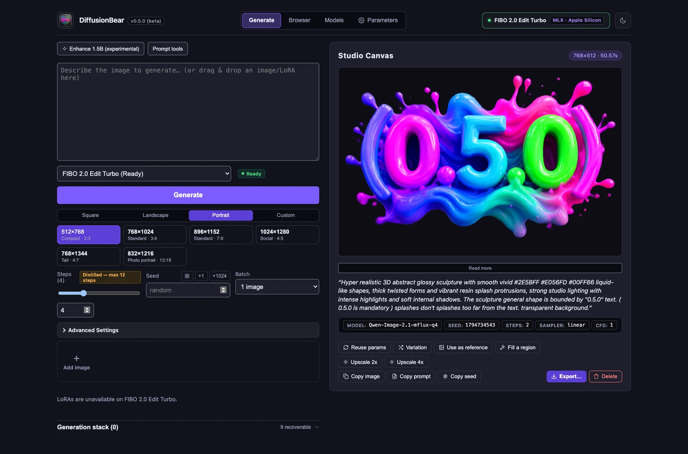 | 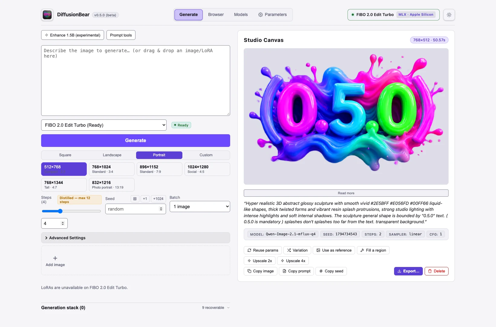 |

| Gallery / Browser (Dark Mode) | Gallery / Browser (Light Mode) |
|---|---|
| 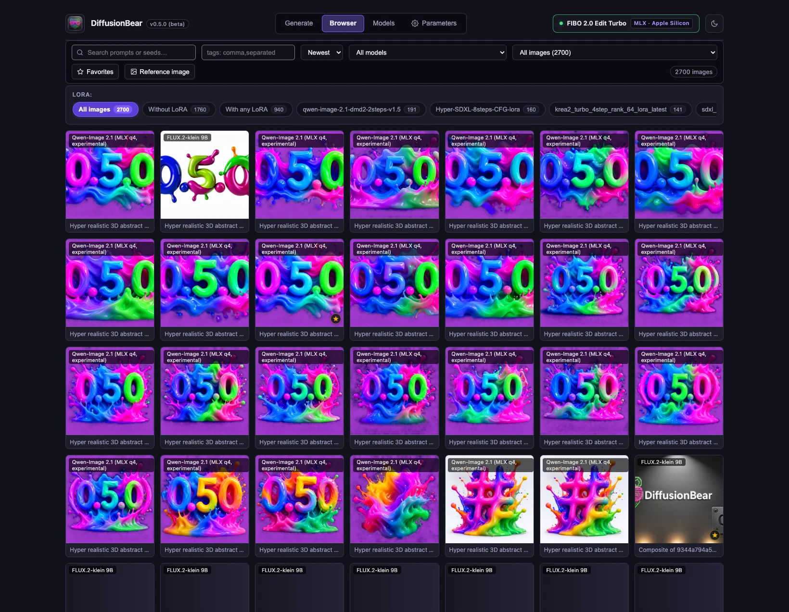 | 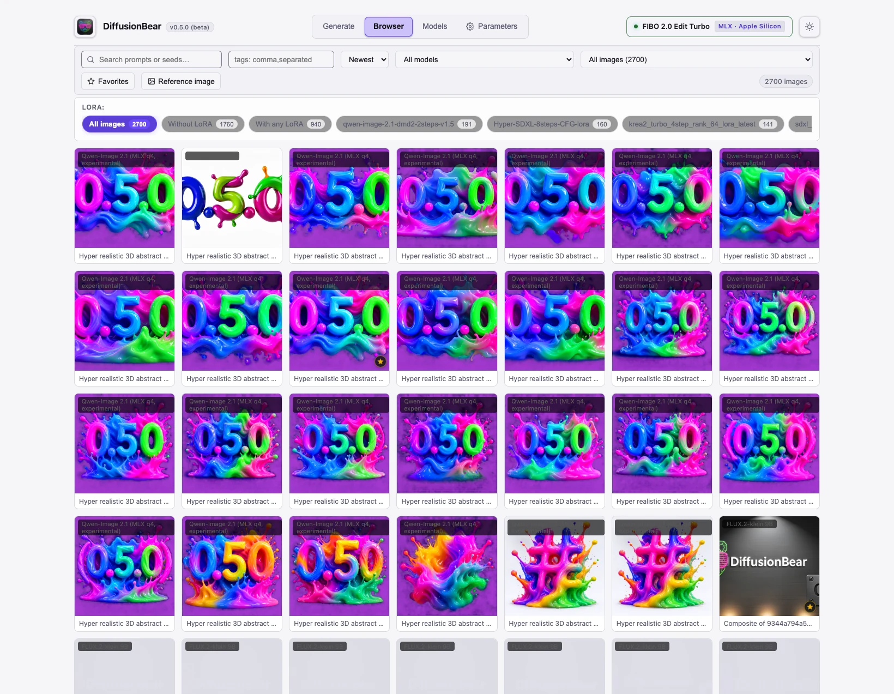 |

| Models: Installed & Integrity Check | Models: Hugging Face Browser |
|---|---|
| 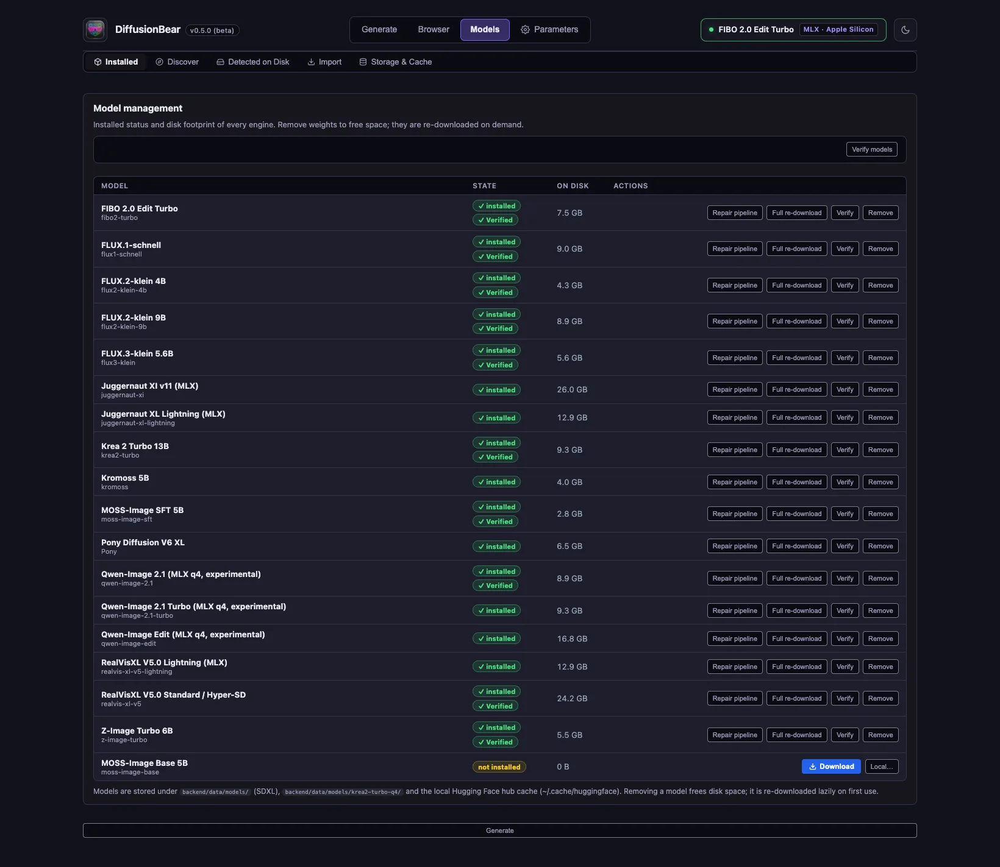 | 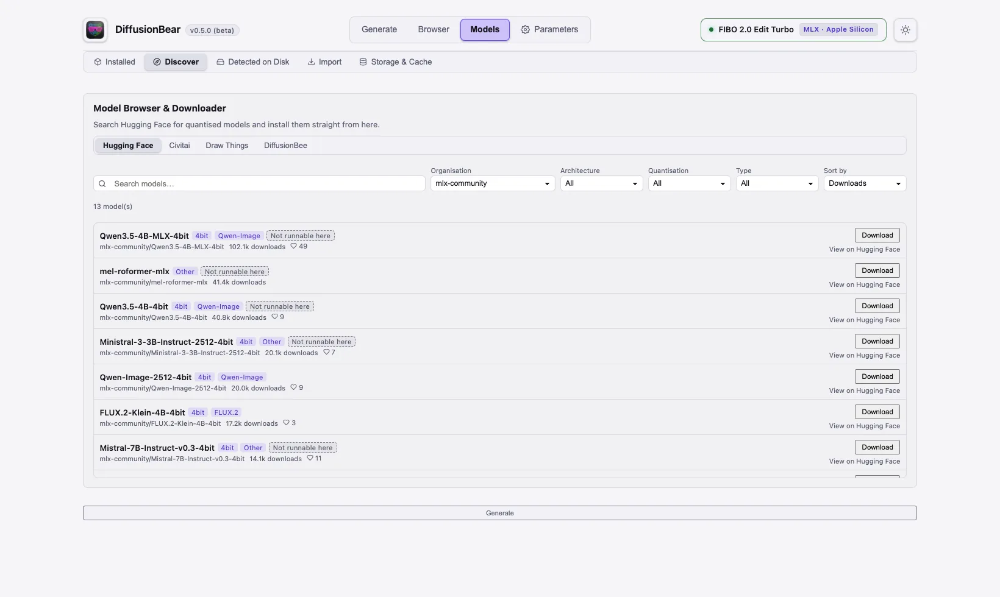 |

| Parameters: Engine, GPU Memory & Model Defaults | Parameters: Language & System Preferences |
|---|---|
| 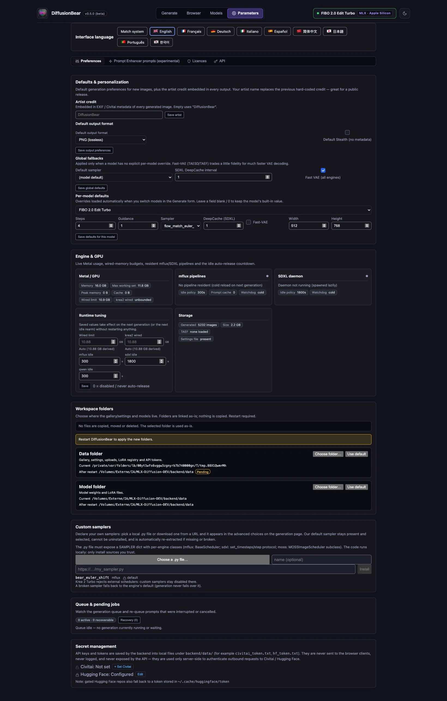 | 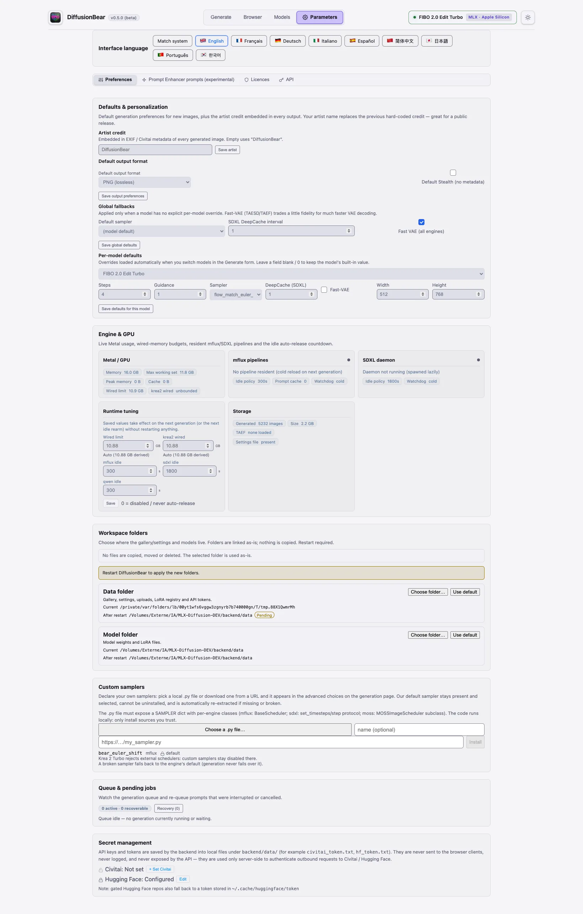 |

| Parameters: API Keys & Remote Access | Parameters: Qwen 2.5 Prompt Enhancer |
|---|---|
| 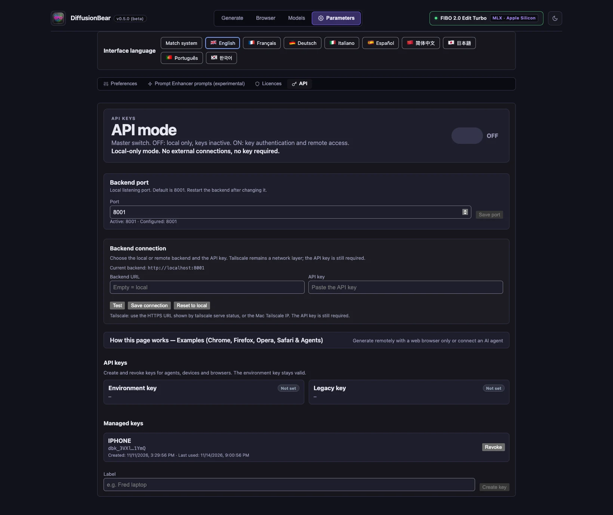 | 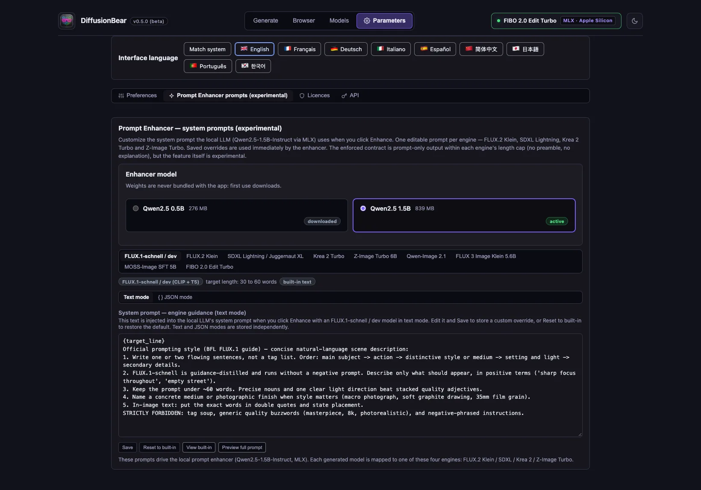 |

| Models: Detected on Disk | Models: Import from Draw Things / DiffusionBee |
|---|---|
| 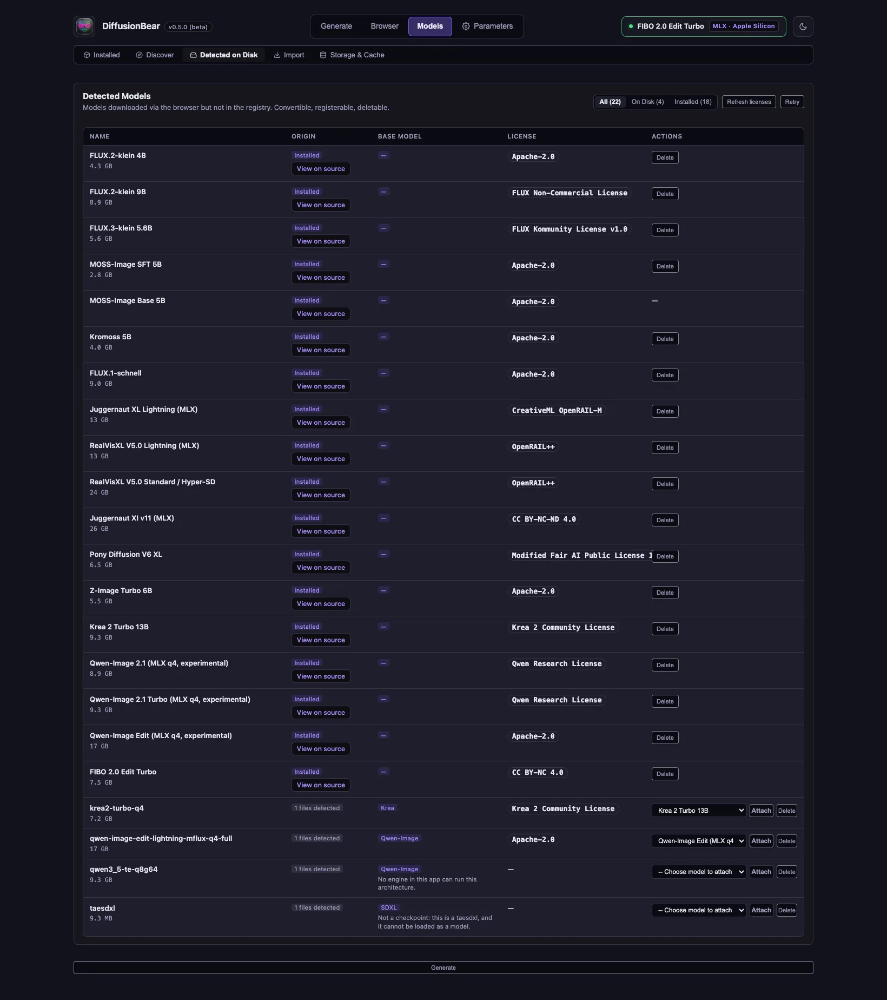 | 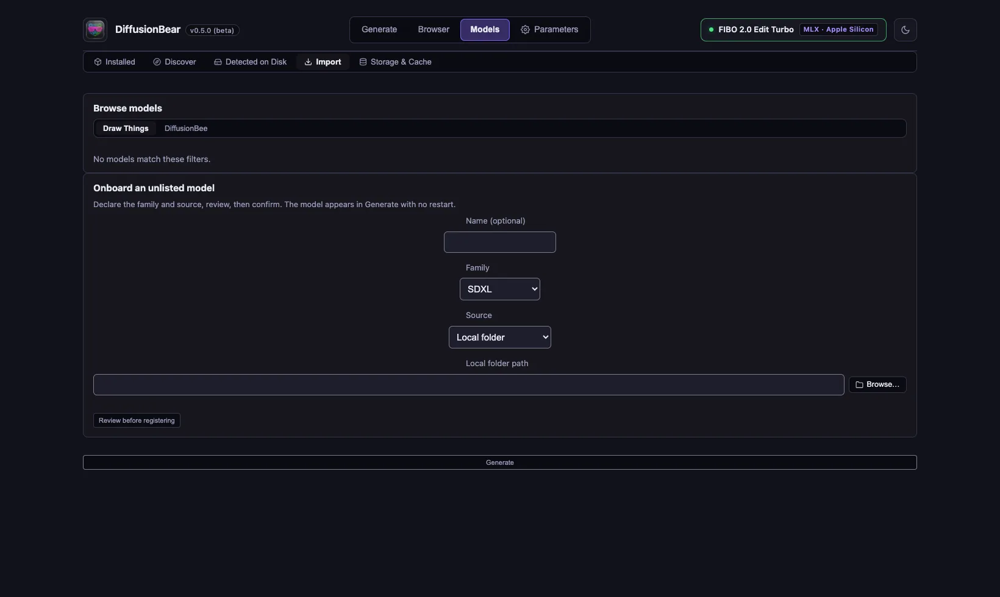 |

---

## Virtual boxes — place things where you want them

Three engines (FLUX.3-klein, MOSS-Image SFT and Base) accept **spatial boxes**:
instead of hoping the model puts the cat in the right corner, you draw a box on
the Studio Canvas and say what belongs inside it. The canvas can show a
reference image as a backdrop, so you compose over the actual picture you want.

- **SPATIAL BOX panel:** presets (Center / Left / Right / Top / Bottom / full
  frame), free boxes you drag on the canvas, and a live count.
- **Compose** turns your caption + boxes into the layout description the engine
  understands; **JSON** shows exactly what will be sent.
- **Reference backdrops:** overlay any gallery image or reference behind the
  boxes, hide it or remove it at will.
- The layout travels with the generation metadata, so reusing parameters
  reproduces the composition.

For FLUX.2-klein, the equivalent is **generative fill**: paint a mask on a
gallery image and regenerate just that region.

---

## Memory management, quietly handled

Running 4–13 B parameter models on a 16 GB Mac is a memory-budget problem. The
app manages it; you watch (Parameters → Engine & GPU) rather than tune:

- **Auto wired-limit.** Each engine's GPU wired budget is derived from your
  machine — `min(68% of unified memory, Apple's recommended working set)`, about
  **10.9 GB on a 16 GB Mac**. An explicit number you set still wins; `0` means
  unbounded.
- **Idle auto-release.** Resident pipelines (a full FLUX/Krea2 pipeline is
  ~10 GB) are released after **5 minutes of inactivity** (300 s default,
  tunable per engine; `0` = never release). Reloading afterwards costs a few
  seconds, not minutes — macOS keeps the weight files in its file cache.
- **Quantised everything.** Weights are 4-bit by default; the MOSS text encoder
  is swapped for the app's own **MLX q8g64 build (~2.2 GB)** and the Krea 2
  encoder is quantised once and persisted, so later sessions skip both the
  7.5 GB bf16 load and the quantisation pass.
- **Live panel.** Metal memory in use, peak, the wired limits, which pipelines
  are resident, and the idle countdowns — all visible, nothing hidden.
- **Storage cleanup.** The Parameters tab reports generated-image size, TAESD
  state and settings, and the Models tab clears per-repo Hugging Face cache
  entries to reclaim disk space.

### MOSS-Image DMD distillation (default behaviour)

Each MOSS DMD kit is three files that only work together: a projection **LoRA**,
a distilled fp32 **time embedding**, and a **dataspace** file holding the
CFG-free step schedule. The **DMD distillation** control has four positions:

| Mode | Adapter used | Schedule |
|---|---|---|
| **Auto** *(default)* | follows the step slider: ≤4 steps → DMD 4, ≤8 → DMD 8, above → stock | stock CFG trajectory above 8 steps |
| **⚡ DMD 4** | darask0's 4-step kit (`moss_distill/darask0-4step`) | CFG-free, engine clamps the run to the 4 codes |
| **⚡ DMD 8** | lodestones' 8-step kit ([`lodestones/MOSS-Image-SFT-8-steps-dmd`](https://huggingface.co/lodestones/MOSS-Image-SFT-8-steps-dmd), Apache-2.0) | CFG-free, engine clamps the run to the 8 codes |
| **Stock** | none | full CFG trajectory at the requested steps (~20–45 min) |

Forcing DMD 4 or DMD 8 at a higher requested step count still runs the 4- or
8-step codes (the engine clamps the loop and drops CFG, which has no effect on
the dataspace schedule). On a 16 GB M1, 4-step DMD2/DMD (`darask0`) measures
**83.57 s median** at 512×768 (**60.45–84.95 s** across 512×512–512×768), against ~41 min stock. If a kit is missing
the app **downloads it automatically** when the run needs it (resumable); with
no network it falls back to the stock trajectory rather than failing.

---

## Agentic Local REST API — Build & Script Locally

DiffusionBear exposes a complete, unthrottled local REST engine at
`http://127.0.0.1:8001` so coding agents (`Claude Code`, `Cursor`, `Antigravity`),
design scripts, and asset pipelines can generate icons, illustrations, edited
mockups, and spatially arranged layouts straight on your Mac's GPU without cloud
keys or per-image billing.

**Full interactive guide & copy-paste agent system prompt:**
**[diffusionbear.com/agentic-api.html](https://www.diffusionbear.com/agentic-api.html)**
&nbsp;·&nbsp; Raw LLM spec:
[site/assets/agentic-api-reference.md](site/assets/agentic-api-reference.md)

**Three-call workflow:**

1. `GET /api/models` — inspect installed models, default dimensions/steps, and capabilities
2. `POST /api/generate` — enqueue a job (`prompt`, `model`, `steps`, `width`, `height`, `loras`, `reference_images`, `mask`, `spatial_boxes`) → returns `{"job_id": "..."}` (HTTP `429` if queue cap is reached)
3. `GET /api/jobs/{job_id}` → poll until `"status": "done"`, then fetch raw bytes from `GET /api/images/{image_id}/file` (or JSON metadata from `GET /api/images/{image_id}`)

```bash
curl -s -X POST http://127.0.0.1:8001/api/generate \
  -H 'Content-Type: application/json' \
  -d '{"model":"flux2-klein-4b","prompt":"flat geometric espresso bear emblem, clean cream paper","steps":4,"width":512,"height":512}'
```

- **Reference edits, inpainting & LoRAs:** upload reference PNGs via
  `POST /api/uploads`, pass `reference_images` + `reference_strength` (or base64
  PNG `mask`), and pre-check LoRA architecture fit with
  `GET /api/loras/{name}/compatibility` and `POST /api/generate/steps/preflight`.
- **Hardened local security (`v0.5.0`):** `LocalHostMiddleware` and
  `LocalAPIMiddleware` restrict traffic to loopback clients by default; enabling
  API Mode via `/api/security/mode` + `/api/security/keys` enforces strong token
  authentication (`Authorization: Bearer`, `X-MLX-API-Token`, or `X-API-Token`)
  before allowing requests.

---

## Local by design

- **Generation runs on the Metal GPU** through MLX (`mflux` for the
  flow-matching families, a native MLX daemon for SDXL, dedicated engines for
  MOSS and Qwen). Weights are 4-bit so a 4–13 B model fits a 16 GB machine.
- **100% PyTorch-free runtime:** `torch`, `torchvision`, `torchaudio`,
  `diffusers`, and `accelerate` are completely removed from the app bundle and
  default backend — every engine executes via MLX, `safetensors`, NumPy,
  `transformers`, and `tokenizers`.
- **The prompt enhancer is a local LLM too** (Qwen2.5 0.5B or 1.5B, MLX) —
  rewriting a prompt never leaves the machine.
- **No telemetry, no analytics, no network calls at generation time.** Once the
  weights are cached the app works fully offline.
- Tokens ([Civitai](https://civitai.com/?ref_code=88C8VEBA) API key, Hugging
  Face token — both optional, both only for smoother downloads of gated or
  rate-limited repos) are stored on your disk and sent only to the service they
  belong to.

Unified memory is why this works at all on a 16 GB machine: the CPU and GPU
share one pool, so a quantised model stays resident with no CPU↔GPU copying —
exactly what MLX is built to exploit.

---

## Benchmarks

Measured on a **2021 MacBook Pro M1 (16 GB)** running **v0.5.0** across **20 model configurations × 11 prompts = 220 timed studio generations** (10 portrait prompts at `512×768` + 1 icon prompt at `512×512`, total suite wall time **5h 47m 38s**; across the **19 matched configs / 209 runs**: **5h 24m 26s** vs **13h 01m 38s** in the reference, **-58.5%** total / **-4.7%** step-matched):

| Model | Steps | Median (`512×768`) | Range (`512×768`) | Family / Notes |
|---|---|---|---|---|
| **Juggernaut XL Lightning** | 4 | **8.80 s** | 8.66 – 12.14 s | SDXL · Native MLX, q4 cache + TAESD (`-9.9%` vs reference) |
| **RealVisXL V5.0 Lightning** | 6 | **15.23 s** | 13.69 – 24.81 s | SDXL · 6-step Lightning, native MLX + TAESD |
| **RealVisXL V5.0** | 8 | **38.78 s** | 38.73 – 43.82 s | SDXL · Hyper-SD 8-step, native MLX (`-16.0%`) |
| **Juggernaut XI v11** | 8 | **41.22 s** | 39.91 – 66.25 s | SDXL · Hyper-SD 8-step, native MLX |
| **FLUX.2-klein 4B** | 4 | **44.09 s** | 44.07 – 44.31 s | FLUX.2 · Compact 4B rectified flow (`-7.2%`) |
| **Qwen-Image 2.1 (2s + DMD2)** | 2 | **46.77 s** | 46.32 – 47.93 s | Qwen-Image · 7B DiT + 2-step DMD2 (`-32.0%`) |
| **FLUX.3-klein 5.6B** | 4 | **51.38 s** | 51.17 – 51.76 s | FLUX.3 · 5.6B flow-matching + Virtual Boxes (`-3.1%`) |
| **FLUX.1-schnell** | 4 | **74.22 s** | 74.07 – 75.02 s | FLUX.1 · Classic 4-step rectified flow (`-16.5%`) |
| **MOSS-Image SFT 5B (DMD 4s)** | 4 | **83.57 s** | 80.61 – 84.95 s | MOSS · Pure MLX 5B DiT + 4-step DMD (`-96.7%` vs 25s stock) |
| **FLUX.2-klein 4B (8s)** | 8 | **89.73 s** | 89.58 – 89.91 s | FLUX.2 · High-detail 8-step mode |
| **Bria FIBO 2.0 Edit Turbo** | 4 | **93.68 s** | 92.32 – 95.03 s | FIBO 2.0 · 4.2B DiT + Qwen3-VL 4B (`-8.3%`) |
| **FLUX.2-klein 9B** | 4 | **96.54 s** | 96.34 – 97.04 s | FLUX.2 · Flagship 9B rectified flow (`-8.0%`) |
| **FLUX.3-klein 5.6B (8s)** | 8 | **98.35 s** | 98.24 – 98.57 s | FLUX.3 · High-detail 8-step mode (`-3.3%`) |
| **Pony Diffusion V6 XL** | 25 | **104.69 s** | 104.56 – 108.74 s | SDXL · Full 25-step anime/illustrative, native MLX (`-4.9%`) |
| **Z-Image Turbo 6B** | 8 | **114.97 s** | 114.86 – 118.35 s | Z-Image · Sharp geometry 8-step (`-1.1%`) |
| **Kromoss 5B (DMD2 8s)** | 8 | **129.43 s** | 128.34 – 137.04 s | MOSS · Pure MLX 5B DiT + 8-step DMD2 LoRA (new in v0.5.0) |
| **Krea 2 Turbo 13B** | 4 | **156.81 s** | 142.20 – 171.97 s | Krea 2 · 13B photorealistic 4-step distilled (`-0.4%`) |
| **Qwen-Image 2.1 Turbo** | 8 | **158.64 s** | 158.08 – 162.12 s | Qwen-Image · 8-step distilled 7B DiT (`-19.4%`) |
| **FLUX.2-klein 9B (8s)** | 8 | **191.38 s** | 191.29 – 191.40 s | FLUX.2 · Flagship 9B 8-step (`-1.5%`) |
| **Krea 2 Turbo 13B (8s)** | 8 | **299.18 s** | 243.57 – 371.42 s | Krea 2 · 13B native 8-step |

For the full interactive visual duel arena, per-prompt latency deltas (`-green` / `+red` vs reference), and historical September baselines, visit **[diffusionbear.com/benchmark.html](https://www.diffusionbear.com/benchmark.html)**.

## Model vs model — visual arena

Head-to-head comparisons on original, royalty-free scenes. Explore interactive side-by-side comparison sliders on **[diffusionbear.com/benchmark.html](https://www.diffusionbear.com/benchmark.html)** or view our video write-up at [ouinche.com](https://www.ouinche.com/mlx-diffusion-yet-another-open-source-image-generator-on-apple-silicon/).


---

## Everything else the app does

- **Model browser & downloader** — search Hugging Face and Civitai side by side,
  classify, download with progress/speed/cancel, direct URLs, and optionally
  convert raw single-file Civitai SDXL `.safetensors` checkpoints out-of-process
  when external `torch`/`diffusers` packages are present (every bundled engine
  runs 100% PyTorch-free on MLX and `safetensors`).
- **Reference images** — FLUX.2/FLUX.3 take up to 10 (`Image 1`, `Image 2`, …),
  Bria FIBO 2.0 takes up to 4 (`image_1` to `image_4`), Z-Image, Krea 2, Qwen
  and FLUX.1 take one; studio-canvas backdrops on the box-capable engines.
- **LoRA manager** — drag a `.safetensors` in or import from Civitai; FLUX.1,
  FLUX.2, FLUX.3, Z-Image, Krea 2 and SDXL (rank-concat stacking) formats;
  trigger words become clickable chips; a LoRA that does not fit the selected
  model is refused *before* generating, with the mismatch named.
- **Prompt enhancer** — local Qwen2.5 0.5B/1.5B rewrites your prompt per engine
  family, prose or JSON, with editable system prompts and trigger-word
  preservation.
- **Custom samplers** — from a local `.py` file or a URL; protected built-in
  default; a broken custom sampler falls back to the engine default, never to a
  failed generation.
- **Queue & recovery** — one generation at a time behind a FIFO worker; a job
  interrupted by a crash or quit is recoverable and re-queueable.
- **Gallery** — tags, search, favourites, one-click Use-as-Reference, 2×/4×
  Lanczos upscaling, Civitai-compliant PNG metadata (with a stealth mode that
  omits it all).
- **Interface** in English, French, German, Italian, Spanish, Simplified
  Chinese, Japanese, Portuguese and Korean.
- **⚖ Licences tab** — the licence of every bundled package and every supported
  model, in one place.

---

## Remote browser & API keys (`Chrome`, `Firefox`, `Opera`, `Safari`, AI Agents)

Because DiffusionBear serves its entire React studio interface from the Mac (`127.0.0.1:8001`), another computer, iPhone, or iPad needs **only one web browser**:

1. **Host Mac (`Parameters → API`):** create a managed key (`dbk_...`) per device, click **Use in this browser**, flip **API mode → ON**, and expose loopback over HTTPS with `tailscale serve --bg --https=443 http://127.0.0.1:8001` (or launch the CLI with `--host 0.0.0.0` on a private LAN).
2. **Remote browser (`Chrome`, `Firefox`, `Opera`, `Safari`):** open `https://<mac>.ts.net` (or `http://<LAN-IP>:8001`), go to **Parameters → API → Backend connection**, **leave `Backend URL` empty** (already talking to the Mac serving the page), paste the key, click **Test → Save connection**.
   - **Chrome:** prefer `https://` via Tailscale Serve (avoids Mixed Content) and allow *Local network access* on LAN HTTP. Keys live per profile in `localStorage`.
   - **Firefox:** open `https://<mac>.ts.net` or a numeric IP (`192.168.x.x` / `100.x.y.z`) if DNS over HTTPS is on, and allow site storage.
   - **Opera:** turn **OFF Opera's built-in VPN** for LAN/Tailscale URLs so traffic stays inside your private network.
   - **Safari (macOS / iOS / iPadOS):** pair Tailscale HTTPS (`https://<mac>.ts.net`) or trusted LAN HTTP (`http://<LAN-IP>:8001`), leave **Backend URL empty**, paste your `dbk_...` key, and tap **Test → Save connection** so all calls and `` thumbnails stay strictly same-origin under *Prevent Cross-Site Tracking*. On iPhone/iPad, **Share → Add to Home Screen** creates a full-screen web app with its own `localStorage` (paste the key once inside the Home Screen app too).
3. **Avoid locking yourself out (`security.json` recovery):** managed `dbk_...` keys are revealed once at creation (stored as SHA-256 hashes) and saved per browser profile (`DiffusionBear.app`, Chrome, Brave, Safari do not share `localStorage`). Save your key in a password manager and click **Use in this browser** before flipping **API mode → ON**. If locked out on your own Mac, edit `~/Library/Application Support/DiffusionBear/data/security.json` (or `backend/data/security.json`) and set `"enabled": false`—your keys stay intact and loopback opens immediately.
4. **AI agents:** send `Authorization: Bearer $DB_KEY` or `X-API-Key: $DB_KEY` on `/api/*` (`GET /api/version` stays public; `GET` image/upload routes accept `?token=` for `` tags). Full guide: [`docs/parameters-api-guide.md`](docs/parameters-api-guide.md) · [`docs/agentic-api-reference.md`](docs/agentic-api-reference.md).

---

## For developers

Everything above is the app; this section is the minimum needed to clone, build
and run it from source.

**Requirements:** an Apple Silicon Mac, macOS 26.2 or later, Python 3.10 (pure
MLX runtime — PyTorch, `diffusers`, and `accelerate` are completely removed
across every bundled engine, including SDXL), and Node.js 18 or later. Git
and Homebrew are only needed to install those prerequisites.

**Clone the repository:**

```bash
git clone https://github.com/OuincheWinch/DiffusionBear.git
cd DiffusionBear
```

**Build the standalone app** (recommended — downloads a self-contained Python
runtime, so no local Python setup is needed). Run the two scripts in order; the
result lands in `packaging/dist/DiffusionBear.app`:

```bash
packaging/build_runtime_venv.sh   # runtime: Python 3.10 + mflux + transformers/tokenizers
INSTALL_APP=1 packaging/build_app.sh   # assembles, signs and installs to /Applications
```

Omit `INSTALL_APP=1` to build without installing. The scripts audit their own
output and fail on absolute build paths, unrelocatable interpreters, weights or
credential-shaped files. Always use the build script's install step — a hand
`cp -R` of a signed bundle is known to silently skip files.

**Run from a checkout** (development):

```bash
python3.10 -m venv venv
./venv/bin/python -m pip install -r backend/requirements.txt
./venv/bin/python -m pip install --no-deps --force-reinstall ./packaging/vendor/mflux-src
cd frontend && npm install && cd ..
./run.sh        # backend on 8001, Vite on 5174, opens the UI
```

Dev mode is `./dev-backend.sh` plus `cd frontend && npm run dev`; lint and build
are `npm run lint` and `npm run build`. Backend tests run with
`./venv/bin/python -m unittest discover` from `backend/`. Ports 8001/5174 are
deliberate — do not "fix" them.

**Public-source export.** `packaging/export_public.sh` builds a filtered tree
(internal docs, tests, scratch excluded), audits it for local paths,
credential-shaped files and weights, and refuses to ship anything unsafe;
`--push` publishes to the public repository.

---

## Documentation

- **[Agentic REST API Guide](https://www.diffusionbear.com/agentic-api.html)** & [site/assets/agentic-api-reference.md](site/assets/agentic-api-reference.md) — local endpoints, agent system prompt, and automation examples
- [CHANGELOG.md](CHANGELOG.md) — what changed in each release
- [RELEASE_NOTES.md](RELEASE_NOTES.md) — release notes and the Gatekeeper guide
- [CONTRIBUTING.md](CONTRIBUTING.md) — how to build, verify and propose a change
- [SECURITY.md](SECURITY.md) — security policy and vulnerability reporting
- [PRIVACY.md](PRIVACY.md) — when the app goes online and what stays local
- [USER_GUIDE.md](USER_GUIDE.md) — full usage guide
- [docs/VirtualBox.md](docs/VirtualBox.md) — How Virtual Boxes work
- [THIRD_PARTY_NOTICES.md](THIRD_PARTY_NOTICES.md) — open-source dependency and model licence notices

---

## Author and AI-assisted development

DiffusionBear is written and maintained by **[Ouinche](https://www.ouinche.com)**
(<https://github.com/OuincheWinch>). Follow on X:
**[x.com/DiffusionBear](https://x.com/DiffusionBear)**.

DiffusionBear is **heavily co-coded by AI** — LLM do a
large share of the writing. That is a deliberate choice, not an accident.

## Security

Please **do not open a public issue** for a security problem. Use GitHub's
[private vulnerability report](https://github.com/OuincheWinch/DiffusionBear/security/advisories/new),
or email the author -hello -at- -DiffusionBear-.-com- with the subject `[DiffusionBear security]`.
Scope is in [SECURITY.md](SECURITY.md). Network behaviour and local data are in [PRIVACY.md](PRIVACY.md).

## Third-party credits

Native MLX MOSS-Image support is adapted from the experimental
[`vanch007/mflux`](https://github.com/vanch007/mflux) branch
`feature/moss-image-sft` (commit `b1fe66cc62109f374fe7d713411c589d3810d0c0`),
which builds on [Filip Strand's mflux](https://github.com/filipstrand/mflux)
under the MIT licence. The vendored adaptation lives in `backend/moss_mlx/`.

MOSS-Image weights are by the OpenMOSS Team (Apache-2.0), converted to MLX Q4 by
mflux-community. The Qwen 3.5 text encoder retains the Qwen licence. Full terms
are in [THIRD_PARTY_NOTICES.md](THIRD_PARTY_NOTICES.md).

- **Built with Qwen**: The local prompt enhancement (Qwen2.5) and Qwen-Image generation capabilities are powered by models from Alibaba Cloud.

### Third-Party Models

- **MOSS & KROMOSS**: Powered by models from the OpenMOSS Team, licensed under Apache 2.0.
- **FIBO**: Generation and editing powered by Bria AI's FIBO models, licensed under CC BY-NC 4.0.

## License & Commercial Model Rights

[MIT](LICENSE) — Copyright © 2026 **[Ouinche](https://www.ouinche.com)**. This
covers DiffusionBear's source code and the packaged PyTorch-free MLX runtime
(`torch`, `torchvision`, `torchaudio`, `diffusers`, and `accelerate` are not
bundled or redistributed). Model weights are never bundled — they are downloaded
directly from Hugging Face or [Civitai](https://civitai.com/?ref_code=88C8VEBA)
under their upstream terms. The in-app **⚖ Licences** tab shows full package
and model terms offline; always verify trademark, copyright, and likeness rights
before commercial sale:

| Model | Upstream Licence | Sell generated images? | Weights / API / key conditions |
|---|---|---|---|
| **FLUX.2-klein 4B**, **FLUX.1-schnell** | `Apache-2.0` | **Yes** | Permissive commercial use & weights (preserve licence/attribution notices) |
| **MOSS-Image SFT 5B**, **MOSS-Image Base 5B**, **Kromoss 5B** | `Apache-2.0` | **Yes** | Permissive commercial use & weights |
| **Z-Image Turbo 6B**, **Qwen-Image Edit** | `Apache-2.0` | **Yes** | Permissive commercial use & weights |
| **Qwen2.5-1.5B / 0.5B Instruct** *(prompt enhancers)* | `Apache-2.0` | **Yes** | Permissive commercial use & weights |
| **RealVisXL V5.0** & **Lightning** | `OpenRAIL++` | **Yes** | Commercial outputs & weights allowed under OpenRAIL++ ethical-use terms |
| **Juggernaut XL Lightning** | `CreativeML OpenRAIL-M` | **Yes** | Outputs allowed; paid API / hosted commercial deployment requires RunDiffusion licence |
| **Pony Diffusion V6 XL** | `Modified Fair AI Public License 1.0-SD` | **Yes** | Outputs allowed; monetized API hosting barred outside Civitai & HF; derivatives stay Share-Alike |
| **FLUX.2-klein 9B** | `FLUX Non-Commercial License` | **Yes** *(Outputs)* | Section 2(d) allows commercial **Outputs** (filters + AI disclosure required); **Weights** remain Non-Commercial |
| **FLUX.3-klein 5.6B** | `FLUX Kommunity License v1.0` | **Conditional** | Free commercial use/outputs under **US$5,000,000/yr** combined gross revenue (filters + AI disclosure) |
| **Krea 2 Turbo 13B** | `Krea 2 Community License` | **Conditional** | Free commercial use/outputs under **US$1,000,000/yr** trailing 12-month revenue incl. affiliates |
| **Qwen-Image 2.1** & **Turbo** | `Qwen Research License` | **No** | Research & evaluation only; commercial deployment requires separate Qwen licence |
| **FIBO 2.0 Edit Turbo** | `CC BY-NC 4.0` | **No** | Non-commercial only; commercial licence available from Bria AI |
| **Juggernaut XI v11** | `CC BY-NC-ND 4.0` | **No** | Strictly non-commercial, no derivatives, no paid API or redistribution without RunDiffusion licence |

*Third-party LoRAs and Civitai checkpoints (e.g., Outlined icons LoRA) carry their own terms shown on the LoRA row in the app.*
